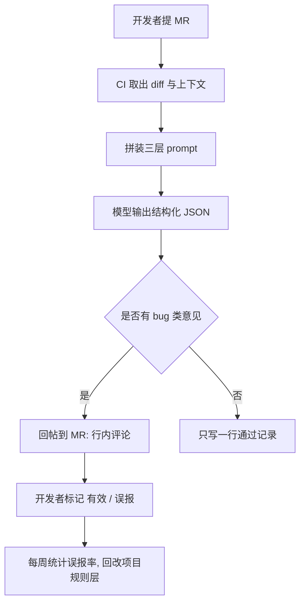

# 把 AI 拉进代码审查：三个月的工程实践

四月开始，我们把 AI 接进了 MR 的评审流程。到今天是第三个月：跑了 412 个 MR，累计提出 1170 条意见，其中被开发者标记为"有效"的 396 条，真正改代码的 231 条。

数字不难看，但中间有两周差点把这套东西关掉，因为误报多到同事开始无视它。这篇记录真正起作用的部分——不是模型有多强，是围绕它做的那些限制。

## 为什么纯人肉 review 会漏低级问题

先说清我们漏的都是什么。翻了三月份的记录，人评审漏掉的问题高度集中：

- 空判断缺失：网络回调里 data 为 nil 还继续取下标
- 资源没释放：播放器、定时器、监听在页面销毁时没解绑
- 主线程 IO：`viewDidLoad` 里同步读大文件
- 边界条件：数组越界、除零、字符串长度为 0

这些不是能力问题，是生理问题。一个 800 行的 diff，人看到第 300 行之后基本只在扫命名和结构；评审当天恰好赶版本，就更倾向于放行。**人会本能地审"这段代码像不像对的"，而不是"逐行确认它是对的"**。

AI 的价值恰恰补在这里：它不会因为 diff 长就降低注意力，也不会因为你是资深就客气。反过来，业务语义它读不懂——一个字段在 A 场景能空、B 场景不能空，这种知识只在需求文档和老同学脑子里。

## 接入流程



关键在最后那条闭环。没有"误报回写规则"这一步，规则层会在一个月内腐化成噪音生成器。我们每周五看一次被标记误报的清单，把重复出现的模式写成明确的排除条款。

## Prompt 分三层，别写成一坨

一开始我写了个 1500 字的"超级 prompt"，把通用规范、项目约定、输出要求全塞一起。结果是改一处就影响全局，而且模型经常漏掉中间几条。后来拆成三层，各自独立维护：

```plaintext
[L1 通用规则层]  几乎不变，团队共享
- 只报告与本次 diff 相关的问题，不评论未改动的代码
- 每条意见必须给出文件、行号、触发条件
- 区分 bug / 风险 / 风格，三类不得混排

[L2 项目规则层]  每两周迭代一次，来自误报清单
- 本项目统一使用 DSNet 封装，禁止直接调用 NSURLSession（已有 lint 覆盖，忽略）
- 埋点上报允许在主线程，队列已做批量合并，不要报卡顿风险
- 播放器实例由 DSPlayerPool 管理，不要建议手动释放

[L3 上下文层]   每次动态拼装
- unified diff（3 行上下文，不裁剪）
- 被改动文件的完整内容（仅当行数小于 400）
- MR 标题与描述
```

L2 是唯一需要长期投入的一层。它的每一条，背后都是一次真实误报。"埋点上报允许在主线程"这条，是因为连续三周 AI 都在同一处报性能风险，开发者骂了两次之后我把它写进规则。

给 L3 传完整文件而不是只传 diff，是准确率提升最大的一次改动：只给 diff 时，模型经常判断错"这个变量在外层已经判过空"。

## 控误报的三招

**第一招：钉死输出格式。** 让模型只输出 JSON，字段固定。自由发挥的评论里，一半是"建议增加注释"这种废话——格式收紧之后，它没法写废话了。

```json
{
  "findings": [
    {
      "type": "bug",
      "severity": "high",
      "file": "DSNetWork/Classes/Public/DSResponseParser.m",
      "line": 128,
      "trigger": "服务端返回 data 为 NSNull 时",
      "evidence": "第 126 行只判了 nil，未判 NSNull，第 128 行直接 objectAtIndex",
      "suggestion": "增加 isKindOfClass:[NSArray class] 判断",
      "confidence": 0.86
    }
  ],
  "summary": "1 bug, 0 risk, 0 style"
}
```

**第二招：强制引用行号和证据。** 规则是"引用不出处就不许提意见"。这一条砍掉了大约四成误报——模型想含糊其辞的时候，写不出具体的行号和触发条件，就自己放弃了。

**第三招：让它自己分桶，并明确授权它闭嘴。** bug、风险、风格三档，只有 bug 档走行内评论、需要开发者回应；风险档折叠成一条汇总；风格档只在 diff 里出现新文件时才提。同时写了一句"如果 diff 中没有确定问题，只输出空的 findings 数组"。模型默认倾向是"总得说点什么"，不授权它沉默，它就编。

分桶之后，开发者对这套系统的态度从"又来刷屏"变成"它标 bug 的时候我得看一眼"。这是能不能活下去的分界线。

## CI 里怎么触发

```typescript
const diff = await exec('git diff --unified=3 origin/main...HEAD');
const files = await readChangedFiles(diff, { maxLines: 400 });
const prompt = [BASE_RULES, projectRules(repoId), buildContext(diff, files)]
  .filter(Boolean)
  .join('\n\n');

const result = await model.generate(prompt, { json: true, temperature: 0 });
const bugs = result.findings.filter((f) => f.type === 'bug' && f.confidence >= 0.7);

for (const item of bugs) {
  await api.createInlineComment(item.file, item.line, format(item));
}
```

三个决定值得说：

- **temperature 设 0**。评审要的是稳定，不是多样性；同一份 diff 两次跑出不同结论，开发者立刻不信任它。
- **confidence 阈值卡 0.7**。低于这个数不回帖，只进周报。宁可漏，不可吵。
- **只审增量 diff，不审存量**。全量扫描听起来美，实际会产生几万条历史问题，第一周就淹死。

## 三个月的真实体感

**它确实擅长的**：空指针和类型误判（`NSNull`、可选值强解）、资源生命周期（定时器没 invalidate、监听没移除）、线程使用（主线程 IO、回调里更新 UI）、明显的边界越界。我们有一次 MR 里把 `dispatch_semaphore_wait` 的超时参数写错，AI 是唯一指出来的。

**它明显不行的**：业务语义。举个例子，退款金额字段在部分退款场景允许为 0，在整单退款场景不能为 0，AI 两次给出相反的建议，因为它只能看到"这里可能除以 amount"。还有跨模块影响——它只拿到 diff 和单文件，判断不了"这个改动会让另一个业务方的缓存失效"。这类问题只有知道历史的人能提。

体感一句话：**它像一个极其认真、但不熟悉业务的实习生**。逐行核对的活交给它，判断"这么改符不符合产品逻辑"的活还得人来。

## 现在还在踩的坑

- 大 MR 会截断上下文。超过 2000 行的 diff 我们直接跳过 AI 评审，同时提醒开发者拆分。
- 规则层越写越长，快到模型的注意力上限了。下一步准备按目录拆规则文件，只在改到对应目录时载入。
- 有开发者开始"为了通过 AI 而写代码"，加一层没用的判空来消警报。这个只能用统计暴露：某个人误报率长期偏高，就单独聊聊。

工具没有把评审变简单，它把评审分成了两部分：机械的部分交给机器，剩下的部分对人说理的能力要求更高了。这三个月最大的收获不是那 231 条修改，是我们被迫把"什么算 bug、什么是风格"这些一直含糊的标准写成了文字。
