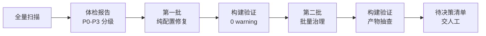

# 用 AI 给博客做工程体检：一次 VuePress 站点治理实战

博客写了几年，攒下 94 篇文章，但最近自己打开首页都觉得不对：分类页是空的、时间线日期全乱、首页列表一半文章没有封面。问题当然知道是"没维护"，但面对 150 MB 的仓库和几十篇跨年度的旧文，人力排查实在无从下手。

这次我试着把治理工作完整交给 AI 执行，要求只有一条：**每个结论必须给出可验证的证据，不允许猜测**。两批执行下来，构建警告从 9 条降到 0，删掉 65 个死文件，修复了影响全站 157 个页面的 SEO bug。这篇文章记录整个过程中真正有价值的部分——不是"AI 很聪明"，而是**哪些活适合交给它，以及怎么验收**。

## 体检流程



关键设计是最后那个"待决策清单"：AI 只执行确定性修复，凡涉及内容取舍（合并哪几篇、删哪个头像）一律列出来等人拍板。这条规则避免了至少三次我可能会后悔的误删。

## 三个典型问题

### 1. hostname 多写一段路径，SEO 链接全站重复

`theme.ts` 里 `hostname` 写成 `https://davidmachile.github.io/vueblog`，而 `base` 已经是 `/vueblog/`，两者拼接后全站每个页面的 `og:url` 都指向不存在的双 base 地址：

```ts
// ❌ 错误：hostname 带了 base 路径
hostname: "https://davidmachile.github.io/vueblog",

// ✅ 正确：hostname 只写域名
hostname: "https://davidmachile.github.io",
```

这个 bug 肉眼永远发现不了——页面浏览完全正常，坏的只有搜索引擎拿到的 meta。验证方式是直接抽查构建产物：

```bash
grep -rL "vueblog/vueblog" src/.vuepress/dist/*.html | wc -l
# 修复前：0 个文件正常；修复后：157 个全部干净
```

**教训**：AI 报告"已修复"不算数，要让它给出验证命令和输出。

### 2. YAML 里的逗号不分割，标签页形同虚设

frontmatter 里这种写法非常常见，也极其隐蔽：

```yaml
# ❌ 这是「一个」标签，叫「西安,旅游,攻略」
tag:
  - 西安,旅游,攻略

# ✅ 三个标签
tag:
  - 西安
  - 旅游
  - 攻略
```

YAML 列表项里的逗号没有分割语义，于是构建出的目录名直接露馅：`dist/tag/西安_旅游_攻略/`。全站 33 个标签里 32 个只被用过一次，标签页等于不存在。批量修复 33 个文件对 AI 是十分钟的事，但它同时给出了一个人类视角的判断：**这是分类法问题，不是格式问题**——格式修完后 53 个标签里仍有 36 个单次使用，真正需要的是人工归并到 15~20 个稳定标签。

### 3. Markdown 里的 HTML 会被当组件解析

老文章里有三处 `<font>` 标签，构建日志一直有 `[Vue warn]: Failed to resolve component: font`。VuePress 2 的 Markdown 会编译成 Vue 模板，旧式 HTML 标签名撞上了组件解析规则，对应位置渲染是坏的。同类问题还有围栏代码块的语言标识：

````markdown
```java文件
// ❌ Shiki 不认识「java文件」，报 Missing highlighter，整块放弃高亮
```

```java
// ✅ 语言标识只能是合法标识
```
````

## 一个意外收获：用哈希给热链图找回本地备份

有篇文章的 4 张图挂在外部图床上。准备清理时发现 `src/posts/img/` 里有几个名字对不上的本地文件疑似旧备份，AI 做了一次哈希比对——imgurl 系图床用**文件 MD5 的中间 16 位**做文件名：

| 热链文件名 | 对应本地文件 | 依据 |
|---|---|---|
| `5bde74cb202dae6c.jpg` | `13适配-5.jpg` | MD5 完全相同 |
| `b3250e888b47f97d.jpg` | `13适配-2.jpg` | MD5 完全相同 |
| `36b27bf08ab59703.jpg` | `13适配-3.jpg` | MD5 完全相同 |

对应关系成立后，把图复制进文章目录、正文改本地路径，这 4 张图从此不再依赖外部图床。这是整次治理里我最喜欢的一处：不是修复，是**破案**。

## 踩过的两个坑

**占位符写法炸构建。** 做隐私脱敏时把真实用户名替换成 `<用户名>` 这种尖括号占位符，Markdown 把它当成未闭合 HTML 标签，`vite:vue` 直接报 `Element is missing end tag`。脱敏占位符别用尖括号。

**删了 65 个文件，dist 反而变大 5 MB。** 删掉的都是源码树里的孤儿文件——Vite 只打包被引用的资源，孤儿本来就不进产物。涨的 5 MB 是开启 mermaid 带来的运行时。**删孤儿文件的收益是仓库干净，不是产物变小**，这两件事必须分开算账，否则汇报数据会说谎。

## 结果

| 指标 | 治理前 | 治理后 |
|---|---|---|
| 构建警告 | 9 条 | 0 条 |
| 全站 SEO meta | 157/157 页面双 base | 全部正确 |
| 全站搜索 | 无 | 已启用 |
| 源码树体积 | 150 MB | 131 MB |
| 单次使用标签 | 32 个 | 36 个（格式对了，归并待人工） |

## 什么样的活适合这样交给 AI

适合：**有明确验收标准的批量劳动**——格式修正、死链检测、哈希比对、跨文件一致性检查。这类活人力成本高、判断规则清晰，AI 做得比人快且不漏。

不适合：内容取舍和分类法设计。它能告诉你"36 个标签只用过一次"，但"旅游/攻略/游记要不要合并成一个"是编辑决策，不是技术决策。

最后一点心得：给 AI 布置这种任务时，把"可验证"写进要求里——"报告每条结论必须附验证命令和输出"。这一句话，能把产出质量从"看着像对"提升到"确实是对的"。
