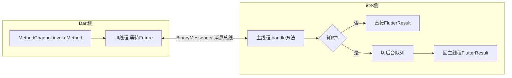

# Flutter Platform Channel 实战：线程模型与大数据传输

混合开发里，Platform Channel 是 Flutter 与原生之间唯一的"官方通道"，也是最容易被用坏的组件——功能上 `invokeMethod` 谁都会写，性能出问题时才知道它对线程和序列化有多敏感。这篇讲通道机制里三个真正要命的工程点：线程模型、大数据编码、以及调用丢失。

## 通道全景：先搞清楚谁在哪个线程



关键事实：原生侧的 `handleMethodCall` **默认在主线程**被调用。这意味着两件事：Dart 调用过来时你在主线程；你在 handler 里做任何耗时操作（读数据库、同步网络、大 JSON 解析），都是在卡 Flutter 的 UI 线程——是的，原生主线程和 Flutter UI 线程在渲染节拍上是一体的，卡一边等于卡两边。

```objective-c
// 原生 handler 的耗时操作必须自己切走
- (void)handleMethodCall:(FlutterMethodCall *)call result:(FlutterResult)result {
    if ([call.method isEqualToString:@"queryOrders"]) {
        dispatch_async(dispatch_get_global_queue(QOS_CLASS_UTILITY, 0), ^{
            NSArray *orders = [self.orderStore queryAll];   // 重活在后台
            dispatch_async(dispatch_get_main_queue(), ^{
                result(orders);  // FlutterResult 回主线程调用
            });
        });
    } else {
        result(FlutterMethodNotImplemented);
    }
}
```

Flutter 3.x 起可以声明 handler 跑在哪个队列（`TaskQueue` 机制），但保守做法仍是上面的手动切线程——兼容性最好，心智负担最小。

## 编码格式：StandardMessageCodec 的性能账

三种内置通道对应三种编解码器，选错就是白付性能税：

| 通道 | 编解码 | 适用 | 开销 |
|---|---|---|---|
| MethodChannel | Standard（类型化） | 常规请求-响应 | 每次调用有序列化+方法分发 |
| EventChannel | Standard | 流式事件（传感器、状态推送） | 同上，但免重复建立 |
| BasicMessageChannel | 自选（String/Binary/JSON） | 高频、大数据 | Binary 几乎零拷贝级 |

**大数据的第一原则：别让 Base64 上场。** 常见反面案例：原生把图片读成 base64 字符串过通道。base64 膨胀 33%，再经过 StandardCodec 的 UTF-8 编码，一张 2MB 的图在通道里变成 4MB 的字符处理，两端各卡一刀。正确姿势是 BasicMessageChannel + BinaryCodec 传字节流，Dart 侧 `Uint8List` 直接接住；或者更彻底——**过通道的永远只是"路径/句柄"，字节走文件**：

```dart
// ❌ 大字节过通道
final image64 = await channel.invokeMethod<String>('getCapture');

// ✅ 通道传路径，字节走磁盘（本地文件读写比通道快且不吃内存峰值）
final filePath = await channel.invokeMethod<String>('saveCaptureToTmp');
final bytes = await File(filePath).readAsBytes();
```

原生↔Flutter 传大 JSON 同理：字典过大时先 `jsonEncode` 成字符串传，或在 Dart 侧用 `compute()` 把解析扔出 UI 线程——通道本身不是瓶颈，主线程反序列化才是。

## 调用丢失：异步时序的暗坑

线上遇到过"原生方法明明执行了，Dart 的 Future 永远不完成"。排查下来是 `FlutterResult` 的经典死法：

```objective-c
// ❌ 错误分支忘记调 result —— Dart 侧 Future 永久挂起
- (void)handleMethodCall:(FlutterMethodCall *)call result:(FlutterResult)result {
    if ([call.method isEqualToString:@"pay"]) {
        [PaySDK pay:call.arguments completion:^(BOOL ok, NSError *e) {
            if (ok) result(@YES);
            // 失败分支忘了调 result！用户看着转圈到天荒地老
        }];
    }
}

// ✅ 铁律：任何路径必须且只能调一次 result
- (void)handleMethodCall:(FlutterMethodCall *)call result:(FlutterResult)result {
    if (![call.method isEqualToString:@"pay"]) {
        return result(FlutterMethodNotImplemented);
    }
    [PaySDK pay:call.arguments completion:^(BOOL ok, NSError *e) {
        result(ok ? @YES : FlutterError(e.domain, e.localizedDescription, nil));
    }];
}
```

两条纪律：**每个分支都有 result**（用 FlutterError 而不是静默）；**result 恰好一次**（completion 被回调两次 = 崩溃或脏状态，包一个 `called` 标志位防御）。另一个隐蔽杀手是 FlutterEngine 重建：原生页面全销毁后引擎重启，旧通道的 `FlutterResult` 闭包全部作废——所以**永远不要跨调用持有 FlutterResult**，一次性消费掉。

## 事件流用 EventChannel，别用轮询式 MethodChannel

原生向 Flutter 持续推事件（GPS、播放进度、长连接消息）时，常见错法是 Dart 侧 `Timer.periodic` 每秒 invoke 一次拉状态。改为 EventChannel 后，原生在真正变化的时刻才 sink，实测一个播放器页面每秒的通道调用从 10 次降到平均 0.4 次，UI 线程的毛刺同步消失：

```dart
final progress = const EventChannel('app/player/progress');
_progressSub = progress.receiveBroadcastStream().listen((v) {
  setState(() => _position = v as int);
});
// 注意：State 销毁必须 cancel，否则 sink 还在推、监听方已没——原生侧空转
```

## 收尾

Platform Channel 的心法就三条，全都是从事故里捞出来的：**通道是窄门，大数据别进门（传路径不传字节）；主线程是共享的，谁卡谁负责（handler 切后台）；Future 是借据，result 必须还清（每分支恰好一次）。** 混合架构的复杂度大多不在"能不能调通"，在"调通之后怎么不出事"——把通道当成网络接口来设计：有超时、有错误协议、有 payload 约定，它就不会在半夜给你惊喜。
