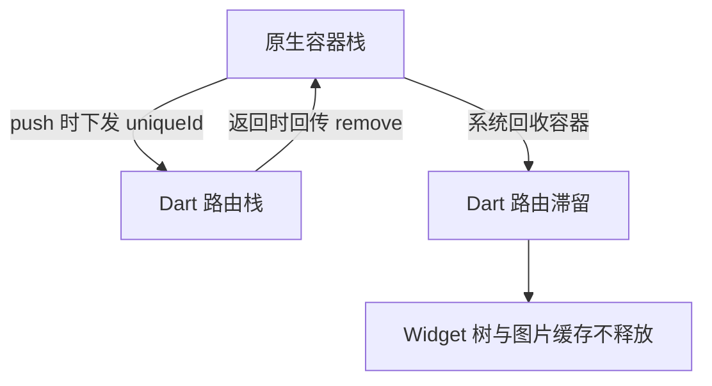

# Flutter 混合工程性能优化笔记

## 场景：页面一层层进，内存一层层涨

我这边 App 主体还是原生，2024 年起陆续把业务模块往 Flutter 上搬，现在是原生加三十多个 Flutter 页面的混合工程，混合栈走的是 Flutter Boost 那一类方案：原生出一个容器（iOS 上是 UIViewController，Android 上是 Activity），容器里放 FlutterView，Dart 侧在自己的 Navigator 里再叠一层路由。

刚接完 demo 时一切正常，测试连点十几层页面再退回去，问题就出来了：

- 退回列表页后，Instruments 里 Resident Memory 几乎不掉，和进去时差不多；
- 从 Flutter 页跳回原生页再进来，偶发第一帧白屏半秒；
- 长列表在低端 Android 上滑动掉帧，DevTools 里红条一片。

前两条是内存和页面栈的问题，后一条是渲染的问题，两笔账得分开算。

## 分析一：混合栈有两套页面栈，但内存只有一份

做原生时养成的直觉是「退页面等于控制器销毁等于内存归还」，混合工程里这条不成立。

Dart 侧的路由（以及 Boost 的容器对象）只有在收到明确的移除指令时才会出栈，底下那棵 Widget 树才会走 dispose。而原生容器什么时候真正销毁是系统决定的：iOS 内存紧张时可以直接回收，但它不会通知 Dart。于是两边容易不一致。



这张图帮我定了排查顺序：先在原生侧打日志，确认容器销毁时 Dart 侧有没有配对的 remove。

另一半原因是引擎常驻。单引擎复用下引擎不销毁，Dart 堆不会因为退出某个页面就还给系统，ImageCache 里的解码结果、还活着的 Element 都算在 App 的常驻内存里。所以混合工程的内存优化，重点往往不是「少建几个 Widget」，而是「退页面时该 dispose 的到底 dispose 了没有」。

## 方案一：先把两边栈对齐，再谈释放

关闭路径必须唯一。跳转、返回、原生侧强制关容器，全部收敛到同一个封装方法里，带上 uniqueId 成对出现。最怕的是有的地方用原生 pop、有的地方用混合栈 pop，这样漏掉的那一条谁也查不出来。

内存告警时的主动让位也值得显式写出来：

```dart
class _DetailPageState extends State<DetailPage> with WidgetsBindingObserver {
  @override
  void initState() {
    super.initState();
    WidgetsBinding.instance.addObserver(this);
  }

  @override
  void dispose() {
    WidgetsBinding.instance.removeObserver(this);
    super.dispose();
  }

  @override
  void didHaveMemoryPressure() {
    // 系统报警时先把图片缓存让出去，比 OOM 之后再救便宜
    PaintingBinding.instance.imageCache.clear();
    PaintingBinding.instance.imageCache.clearLiveImages();
  }
}
```

`clear` 之后已展示的图会重新解码，代价是流量和解码时间，所以只在告警时调，不要每个页面 onPageHide 都清。页面自己持有的大图，在 dispose 里主动 `evict` 更划算。

## 分析二：重建和重绘是两件事

Flutter 的 build 沿子树往下走：父 Widget 重建，子的 build 默认也会跟着跑一遍。唯一的短路是新旧 Widget 实例 `==` 相等（`const` 保证同一份字面量拿到同一个实例），Element 直接复用，不再往下。所以「顶部一个小红点变了，整页重刷」就是这么来的。

重绘是另一笔账：即使没有任何重建，脏区大、图层多、有大图或者模糊阴影，Raster 线程照样能超过 16.7 毫秒。

## 方案二：把 build 的爆炸半径压小

- 不变的子树一律 `const`，这是最便宜的优化，没有之一；
- 把会变的值下推到叶子节点，别在最外层 build 里读全局状态；
- 用 `ValueListenableBuilder` 或者 provider 的 `Selector` 只包住真正会变的那一小块；
- 列表项给稳定的 `Key`，别让 Element 白白重挂。

想让「值没变就不更新」，有两条路：自己实现 `==` 和 `hashCode`（父节点重建时 `updateChild` 会直接复用子 Element），或者在 RenderObjectWidget 里重写 `shouldRebuild`——这个钩子 StatelessWidget 没有，所以实践中更常用的是把不变的部分提成 const 子组件。

```dart
class StatValue extends StatelessWidget {
  const StatValue(this.value, {super.key});

  final int value;

  @override
  bool operator ==(Object other) => other is StatValue && other.value == value;

  @override
  int get hashCode => value.hashCode;

  @override
  Widget build(BuildContext context) => Text('$value');
}
```

重绘这边，在滚动区和动画外面套一层 `RepaintBoundary`，让它单独成图层，兄弟节点重绘时不带它。注意 `ListView` 默认已经给每个 item 包了一层（`addRepaintBoundaries` 默认为 true），别顺手关掉。

## 方案三：列表别把开销留给测量

`ListView.builder` 只解决懒构建，滚动位置计算和预加载还得靠参数：

```dart
ListView.builder(
  cacheExtent: 500,              // 默认约 250 逻辑像素，控制屏幕外预构建的量
  itemExtent: 88,                // 行高固定时给出：跳过逐项测量，滚动位置可直接算
  addAutomaticKeepAlives: false, // 不需要保留每项状态的长列表，关掉省内存
  itemCount: items.length,
  itemBuilder: (context, index) => RowCell(items[index]),
);
```

`cacheExtent` 是取舍：调大，快滑不容易出现白块；调小，屏幕外缓存的 Element 和图片更少。行高不固定可以用 `prototypeItem` 传一个样板 item。另外别在 `itemBuilder` 里做解析、排序、日期格式化，它会随着来回滚动被反复执行。

## 方案四：图片才是混合工程最大的单块内存

一张 3024 乘 4032 的图解码进内存，按每像素 4 字节算差不多 47MB，而它在列表里只占 90 乘 90 逻辑像素。所以要在解码阶段就缩：

```dart
Image.network(
  url,
  cacheWidth: 240,     // 解码期缩放，单位是物理像素；只给宽会按比例算高
  memCacheWidth: 240,  // 进入 ImageCache 时保留的尺寸
  fit: BoxFit.cover,
)
```

`cacheWidth` 省的是内存和显存，代价是多花解码时间，大图首帧会更慢一点，所以列表里用、大图预览页不要用。全局还有 `PaintingBinding.instance.imageCache.maximumSizeBytes`（默认 100MB 左右）兜底，混合工程页面多的时候可以适当调小，但要配合前面的主动释放。

## 工具：把猜测变成证据

`showPerformanceOverlay` 打开后，真机顶部常驻两条曲线，上面那条是 Raster 线程，下面是 UI 线程；DevTools 的 Performance 页能看单帧的红条并点进火焰图。查重建时用 Widget Inspector 的 Track widget rebuilds，重建的节点会闪出边框，比加 print 快得多。也可以在关键流程里用 Timeline 打自定义任务，把「网络回来之后到上屏」这一段单独标出来。

| 现象 | 先看哪条线 | 常见原因 | 处理方向 |
| --- | --- | --- | --- |
| 滑动时下面那条红 | UI 线程 | build、layout 太重 | const、itemExtent、清掉 itemBuilder 里的计算 |
| 静止也卡、动画掉帧 | Raster 线程 | 重绘面积大、大图上传 | RepaintBoundary、cacheWidth、少用模糊阴影 |
| 进页面白半秒 | Timeline 首帧 | 引擎冷启动、同步解析数据 | 预热引擎、先渲染占位再填数据 |
| 退回后内存不降 | Dart 堆快照 | 路由滞留、缓存没清 | 关页成对 remove、主动 evict、告警时 clear |

## 小结

混合工程的性能问题，多数落在两件小事上：一是两套页面栈没对齐，退页面时该释放的没释放；二是把重建和重绘混为一谈，优化使错了地方。前者靠「关闭路径唯一加不可见时主动释放」，后者靠两条曲线分流——UI 线程红就往 const、列表参数、itemBuilder 里找，Raster 线程红就往重绘面积和图片尺寸上找。按这个顺序排查，比一页一页试错省时间得多。
