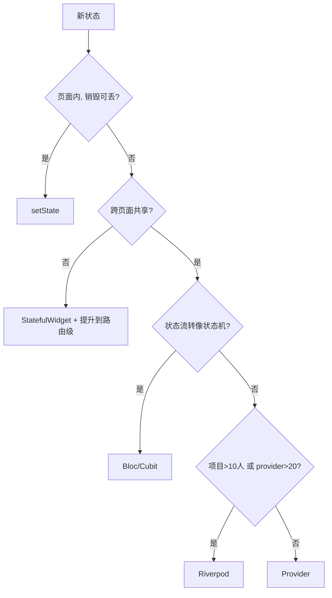

# Flutter 状态管理选型：从 setState 到 Riverpod 的一次实战对比

Flutter 的状态管理方案多到像保健品货架：Provider、Riverpod、Bloc、GetX、MobX……每篇教程都说自己的方案是终点。去年把一个中型 Flutter 工程从 Provider 迁到 Riverpod，前后踩的坑拿来做个横向对比，顺便回答一个问题：**到底什么时候才值得从 setState 毕业。**

## 先给结论

| 方案 | 学习成本 | 可测试性 | 编译期安全 | 适用场景 |
|---|---|---|---|---|
| setState | 零 | 差 | — | 单页局部状态（开关、输入框） |
| InheritedWidget | 高 | 中 | 弱 | 手写方案的底座，一般不直接用 |
| Provider | 低 | 好 | 弱（context 查找） | 中小项目，依赖树即作用域 |
| Riverpod | 中 | 好 | 强（code generation） | 中大型项目，依赖关系复杂 |
| Bloc | 中高 | 好 | 中 | 状态流转复杂的业务页（表单流、多状态机） |
| GetX | 低 | 差 | 弱 | 全家桶快速出活，长期维护慎选 |

这张表是我们项目验证过的口径，选型逻辑在下面展开。

## setState 没有输，它只是有边界

先说公道话：页面内一个 Tab 切换、一个展开折叠，用 setState 就是最优解，引任何库都是负担。它的问题只有一个——**状态挂在 Widget 上**。Widget 树重建、页面销毁重建，状态跟着没了；两个不相邻的页面共享一个状态，就得往上升 Lifting State，升着升着根 Widget 就胖成球。

```dart
// 边界现场：页面跳走再回来，count 归零
class CounterPage extends StatefulWidget {
  @override
  _CounterPageState createState() => _CounterPageState();
}

class _CounterPageState extends State<CounterPage> {
  int _count = 0; // 状态生命周期 == State 生命周期
  // ...
}
```

什么时候该毕业：出现"这个状态要在页面销毁后还活着"或者"两个组件要读写同一份数据"，这两个信号之一出现，就该上外部状态容器了。

## Provider：够用，但 context 是温柔陷阱

Provider 的模型是"沿 Widget 树挂一个数据，子树消费"。上手极快，`ChangeNotifierProvider` + `Consumer` 两小时能改造完一个页面。但它的一切都建立在 BuildContext 上，而 context 是运行时查找：

```dart
// 运行时才炸的两个经典现场
final user = context.watch<UserNotifier>();
// 崩溃1: 上面忘了包 Provider —— ProviderNotFoundException
// 崩溃2: 在 initState 里调用 —— 编译通过，运行时 "Tried to listen to a value exposed with provider, from outside of the widget tree."
```

翻译一下：Provider 把依赖关系藏在 Widget 树的结构里，**树结构调整的瞬间就是依赖断裂的瞬间**，而编译器全程沉默。项目小时这不算事；页面嵌套上百个、Provider 挂到二十多个之后，"这个 context 往上找不找得到 X"就变成了口口相传的部落知识。

## Riverpod：把依赖关系从树上搬到编译期

Riverpod 与 Provider 的心智模型差异就一句话：**依赖不再由 Widget 树位置决定，而是由代码里的引用决定。**

```dart
// provider 定义即全局可达，不依赖任何 context
final cartProvider = NotifierProvider<CartNotifier, List<Item>>(CartNotifier.new);

class CartNotifier extends Notifier<List<Item>> {
  @override
  List<Item> build() => [];

  void add(Item item) => state = [...state, item];
}

// 消费端：consumer 自己声明要什么，ref 替代 context
class CartBadge extends ConsumerWidget {
  @override
  Widget build(BuildContext context, WidgetRef ref) {
    final count = ref.watch(cartProvider).length;
    return Badge(count: count);
  }
}
```

对我们帮助最大的三点：

**第一，测试不再需要"包壳"。** Provider 时代测一个组件要先构造一堆 `ChangeNotifierProvider` 外壳；Riverpod 的 `ProviderContainer` 直接注入假实现，`container.read(fakeCartProvider.notifier).add(item)`，两行完成。迁移后单测编写时间大约砍半。

**第二，异步状态是一等公民。** `FutureProvider` + `ref.watch` 自动得到 loading/data/error 三态，不用每个接口手写三个布尔值。配合 `AsyncValue.when()` 的写法，错误分支强制处理，漏写编译不过。

**第三，依赖图可推导。** provider 之间通过 ref 互相引用构成静态图，循环依赖在 codegen 阶段就被揪出来——这在 Provider 时代是运行时惊喜。

代价也说清楚：全家桶文档质量参差（尤其中文）、code generation 链路多一道 build_runner、老同事的 context 肌肉记忆要改。我们评估过 Bloc，它的事件流模型更适合状态机复杂的核心页，但团队规模撑不起每个页面一套 Event/State/Bloc 三件套的心智负担——**方案选型是团队问题，不是技术排名问题。**

## 决策路径



最后一条心得来自迁移本身：状态管理没有银弹，但有一个普适判据——**好的状态管理方案，让"数据从哪来、谁在监听、什么时候销毁"这三个问题，都能在编辑器里回答，而不是在断点里回答。** 按这个标准去看货架上的瓶瓶罐罐，选择会清晰很多。
