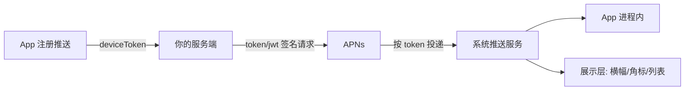

# 从使用到了解 APNs：推送链路的坑与排错手册

推送是最容易被低估的链路——接的时候觉得"不就是发个通知吗"，上线后排查问题才知道它横跨 App、服务端、苹果、系统设置四个环节，哪一环都能让消息无声消失。这篇把踩过的坑和排错顺序整理成手册。

## 先看清整条链路



排错第一原则：**先定位消息死在哪一段**，再谈修复。九成的"推送收不到"根本不是代码问题，而是死在 token 注册环节或系统设置里。

## 注册环节：token 不是你以为的那样

**token 会变，而且比想象中频繁。** 系统更新、还原网络设置、卸载重装、甚至用户换机恢复，deviceToken 都可能变。所以每次启动都要调 `registerForRemoteNotifications`，并把新 token 上报服务端做 upsert——我们线上曾经只做首次注册上报，用户系统升级后推送全灭，服务端还在往废 token 发。

```objective-c
- (void)application:(UIApplication *)app
    didRegisterForRemoteNotificationsWithDeviceToken:(NSData *)token {
    // token 是二进制，服务端要的是无空格无尖括号的大写十六进制
    const unsigned char *bytes = token.bytes;
    NSMutableString *hex = [NSMutableString stringWithCapacity:token.length * 2];
    for (NSUInteger i = 0; i < token.length; i++) {
        [hex appendFormat:@"%02X", bytes[i]];
    }
    [self.reporter uploadToken:hex]; // 每次启动都上报，服务端按 token+userId 幂等覆盖
}
```

老代码里常见的"去尖括号"处理（`<a1b2c3...>`）是历史包袱：`description` 输出带尖括号和空格，当年大家用正则剥壳。现在直接遍历 `bytes` 格式化，别再碰 `description`。

**授权时机比 token 更早出问题。** iOS 10 之后必须显式 `requestAuthorizationWithOptions:`，用户在设置里点了"不允许"，注册照样成功、`didRegister` 照样回调，但消息永远不会展示——这是"服务端显示发送成功，用户说没收到"的经典来源。排错时永远先问：设置里这个 App 的通知开关是开着的吗？

## 服务端环节：三种"发送成功"都不是真成功

**Token 认证（JWT）已取代证书，但坑换了个形态。** JWT 用一个 `.p8` 私钥 + keyId + teamId 签名，有效期 50 分钟——有人把它签成常驻字符串缓存，一小时后所有请求 403 `ExpiredProviderToken`。签名逻辑必须每次临用临签。

**APNs 返回 200 只代表"苹果收下了"，不代表"设备收到了"。** 苹果收下后投递失败（token 失效、用户卸载），会走 feedback 通道（新版是 BadDeviceToken 同步响应 + 后续连接关闭里的 reason）。服务端必须消费这些失败信号清理 token，否则废 token 越积越多，还被苹果限流。

| APNs 响应 | 含义 | 服务端该做 |
|---|---|---|
| 200 | 已接受，异步投递 | 记录，等失败反馈 |
| 400 BadDeviceToken | token 与环境不匹配 | 区分 sandbox/production 环境字段，清理 |
| 410 Unregistered | App 已卸载 | 立即删除 token，不要重试 |
| 429 | 被限流 | 退避，检查是否重发风暴 |
| 5xx | 苹果故障 | 指数退避重试 |

**sandbox 和 production 的 token 不通用**，且同一个 bundle id 的两种环境 token 长得一样——排查时先看服务端发的 endpoint 是 `api.development.push.apple.com` 还是 `api.push.apple.com`。测试包收不到正式推送，十次有八次是这个。

## 展示环节：payload 里能埋的雷

**mutable-content 没给，富媒体白做。** 想在通知里带图片（Notification Service Extension 下载附件），payload 必须带 `"mutable-content": 1`，否则系统直接用原始内容展示，Extension 根本不会被拉起。

**静音推送有额度。** `content-available: 1` 的静默推送用于后台拉数据，系统按 App 的使用习惯限流，且用户开了低电量模式可能不触发。把核心业务逻辑押在静默推送上，就要接受它可能永远不来——只能当"尽力而为"的触发器，数据以拉取兜底。

**角标要自己管。** iOS 不会帮你清角标，服务端 payload 里的 `badge` 是绝对值不是增量。我们用"服务端存未读数，推送时带当前总数，App 进前台清零再上报"的闭环，避免了"已读消息角标还在"的老问题。

## 排错顺序（贴在工位上）

1. 设备设置里通知开关开了吗？
2. 端上 `didRegister` 回调里 token 上报成功了吗？服务端存的 token 是最新的吗？
3. 服务端用的 endpoint 和 App 构建环境匹配吗？
4. APNs 返回码查表，有 BadDeviceToken/Unregistered 吗？
5. 返回 200 但没展示：查 payload 的 `mutable-content`、静默标记、通知栏是否被专注模式拦截。
6. 展示了但内容不对：查 Notification Service Extension 的签名与 entitlements 是否和主 App 一致。

按这个顺序走完，推送问题基本无处遁形。推送链路的难点从来不在"发出去"，而在"确认它该到、到了、且被看见"——把这条链路的每个观测点都打通，比优化任何单个环节都有用。
