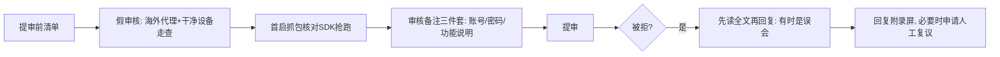

# App Store 被拒录：那些 Guideline 教会我的事

这个月的新版本又被 App Review 驳回了，理由还是那条让人爱恨交织的 **Guideline 2.1 - App Completeness**。看着审核邮件里"we noticed..."开头的英文，我决定把这几年的被拒记录整理出来——被拒不可怕，同一块石头绊两次才疼。

## 被拒的五种典型死法

| Guideline | 场景还原 | 通过率杀手 |
|---|---|---|
| 2.1 完成度 | 审核账号功能残缺/测试入口没给 | 演示环境挂了 |
| 2.5 启动行为 | 冷启动弹隐私同意前就初始化三方 SDK | 三方 SDK 在 `didFinishLaunching` 抢跑 |
| 3.1.1 业务展示 | App 主体是"套壳"网页内容 | 内容占比过高 |
| 4.2 最低功能 | 工具类小 App 功能太薄 | 只有一个 WebView |
| 5.1.1 收集数据 | Info.plist 声明了权限但用途说不清 | 用了相册却说不清为什么要相册 |

## 死法一：审核时环境挂了（2.1）

最常见的冤案：你明明一切正常，审核员看到的却是空白页。原因无非三类：

1. **审核账号过期/被限流。** 你在备注里给的测试账号，密码改过了；或者风控把审核员 IP 当爬虫封了。做法：维护一个"审核专用账号"，白名单豁免风控，备注里写死密码永不修改，并在 Release Note 的审核备注栏再次强调。
2. **依赖的国内接口对海外 IP 超时。** 审核服务器在美国，你的预发环境连了办公网 VPN 才能访问的中间件——审核员视角里 App 直接假死。
3. **功能有灰度。** 审核版本恰好落在灰度关闭区间，主页大半个入口不见了。

```objective-c
// 审核模式开关：远端配置 + 本地兜底，提审期间锁定全量展示
- (BOOL)reviewSafeModeEnabled {
    static BOOL flag;
    static dispatch_once_t once;
    dispatch_once(&once, ^{
        flag = [[NSUserDefaults standardUserDefaults]
                boolForKey:@"daisz_review_safe_mode"]; // 提审前用配置下发置 1
    });
    return flag || [self isReviewerIPRange]; // 本地兜底判断
}
```

原则是：**提审窗口期内，功能展示求全不求新**。灰度暂停两天，天塌不下来；被拒一次，一周一轮重新排队。

## 死法二：SDK 抢跑隐私弹窗（2.5 / 5.1.1）

苹果现在的红线是：用户点掉"同意隐私政策"之前，任何数据采集（包括设备标识、网络上报）都不允许。很多三方 SDK 在 `+load` 或 `didFinishLaunching` 里自己就初始化了，采集发生在弹窗展示前——这在自动化审核里一抓一个准。

排查方法不是读源码，是**看网络包**：首启不点同意，挂个抓包代理，看 App 在弹窗存续期间有没有任何出站请求。有，就顺着域名找是哪个 SDK。解法：所有三方 SDK 的初始化挪到"同意回调之后"的统一初始化器里，用启动任务清单逐个登记（这套机制和冷启动那篇的任务清单是同一套基础设施——一次建设，两处收益）。

## 死法三：权限用途说不清（5.1.1）

Info.plist 里 `NSPhotoLibraryUsageDescription` 写"用于上传图片"，驳回。审核要的不是"用在哪"，而是**为什么非用不可**：

```plaintext
❌ 用于访问相册
✅ 您在"意见反馈"和"头像设置"页面可主动选择相册图片上传；
   App 不会在未经您操作时访问相册，也不会上传相册中的其他图片。
```

后半句"不会做什么"往往比前半句"会做什么"更能说服审核员。同理，权限申请时机要收敛——一启动就三连弹（通知+相册+定位）是标准的拒审诱饵，改成"用户点到对应功能时才弹"。

## 死法四：3.2 商家支付（升级重灾区）

虚拟商品走 IAP 这条线近两年抓得极严：课程、会员、加油包，哪怕你在页面藏得再深，审核录屏里漏一次外链支付引导就是拒。规则本身不复杂——数字内容解锁一律 IAP，实物服务走外部支付。灰色在于"组合商品"：一门线上课送纸质讲义，算虚拟还是实物？审核员说了算，申诉成功的案例我见过，但成本是两周排期。**产品设计阶段就把这条规则输入进去，比被拒后改造便宜一百倍。**

## 和被拒共处的工作流

几年下来，我把被动挨打改成了主动防御：



两个反直觉经验：其一，**被拒后别急着改代码**，先通读邮件全文，三分之一的驳回是模板误伤，一封礼貌清晰、附录屏的回复就能过；其二，**Appeal（人工复议）不是撕破脸**，它是苹果提供的正规通道，用过三次，成功两次，代价只是多等三天。

Guideline 那几百条，读的时候像天书，被拒三次之后就成了肌肉记忆。愿你的提审记录里，"Ready for Sale" 比 "Prepare for Submission" 多得多。
