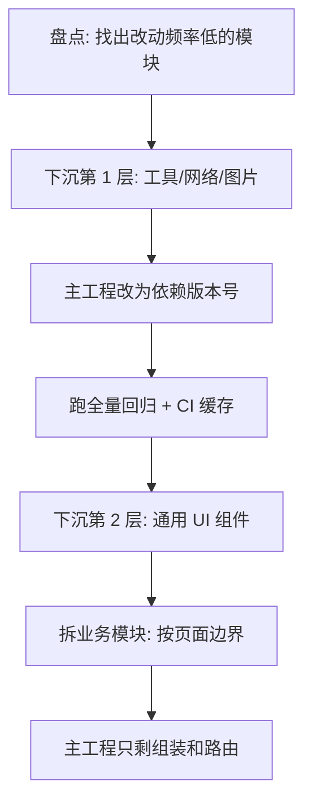

# 用 CocoaPods 私有库给老工程减负的完整流程

去年下半年我们开始给主工程做拆分。起因很实在：一个 40 万行的 OC 工程，改一个网络层的小 bug 要全量编译 7 分钟；两个人同时改 `BaseKit` 里的工具类，一周撞了三次冲突。拆私有库不是为了追时髦，是为了让"改一块不用重编全部"。

半年下来拆出 6 个私有库，踩的坑集中在 podspec 字段和静态库链接上。这篇按实际流程记一遍，命令和报错都是真的。

## 私有 spec repo：一次配好，长期省事

spec repo 只是一份索引仓库，里面放 podspec，不放代码。代码在自己的库仓库里，podspec 的 `source` 字段指向它。

```bash
# 1. 在内部 Git 上建一个空仓库 ds-specs，然后挂到本地
pod repo add ds-specs git@内部Git主机:ios/ds-specs.git

# 2. 建业务库骨架（模板选 Static Library，非开源、无 example 更清爽）
pod lib create DSNetWork

# 3. 业务库打 tag 后推送索引
git tag -a 1.0.0 -m "DSNetWork 1.0.0"
git push origin 1.0.0
pod repo push ds-specs DSNetWork.podspec --sources=git@内部Git主机:ios/ds-specs.git --allow-warnings
```

`pod repo push` 做的事是：本地跑一遍 lint，通过之后把 podspec 复制到 spec repo 并 push。索引仓库推上去了，别人 `pod install` 才能按名字找到它。

日常迭代就三步：改代码、打新 tag、`pod repo push`。我把这三步写进了一个 `release.sh`，因为手打容易漏 tag，而漏 tag 是第二天最费时间的故障。

## podspec 里真正影响结果的字段

```yaml
Pod::Spec.new do |s|
  s.name         = 'DSNetWork'
  s.version      = '1.0.0'
  s.summary      = '统一网络层，含签名、重试与埋点'
  s.homepage     = 'git@内部Git主机:ios/ds-network'
  s.license      = { :type => 'MIT', :text => 'Internal use only.' }
  s.author       = { 'daisz' => 'daisz@example.com' }
  s.source       = { :git => 'git@内部Git主机:ios/ds-network.git',
                     :tag => s.version.to_s }

  s.platform              = :ios, '12.0'
  s.requires_arc          = true
  s.source_files          = 'DSNetWork/Classes/**/*.{h,m}'
  s.public_header_files   = 'DSNetWork/Classes/Public/**/*.h'
  s.resource_bundles      = { 'DSNetWork' => ['DSNetWork/Assets/**/*'] }
  s.frameworks            = 'CFNetwork', 'Security'
  s.dependency 'AFNetworking', '~> 4.0'
  s.dependency 'DSCore', '~> 1.2'
end
```

几个字段的影响比想象大：

- **`source_files`**：决定编译范围。用 `**/*` 一把梭很爽，但一旦目录里混进测试代码或旧实现，会被静默编进去。我们的规矩是 `Classes/` 只放产物代码，其他一律不放。
- **`public_header_files`**：不给外部暴露的头文件不写进来。这一步不做，半年后没人敢动内部实现，因为不知道谁在引用。私有库的价值恰恰在"内部实现可以随便改"。
- **`resource_bundles` 而不是 `resources`**：`resources` 会把文件直接铺进主 bundle，两个库放同名图片就互相覆盖。`resource_bundles` 打成独立的 `xxx.bundle`，代价是取资源要换 bundle。
- **`dependency` 的版本约束**：写 `~> 1.2` 而不是裸版本号，也不要不写。不写等于每次 `pod install` 都可能被上游新版本掀翻。

从 bundle 里取资源，得这么写：

```objective-c
+ (NSBundle *)ds_resourceBundle {
    NSBundle *candidate = [NSBundle bundleForClass:self];
    NSURL *url = [candidate URLForResource:@"DSNetWork" withExtension:@"bundle"];
    if (url == nil) {
        url = [[NSBundle mainBundle] URLForResource:@"DSNetWork"
                                    withExtension:@"bundle"];
    }
    return url ? [NSBundle bundleWithURL:url] : candidate;
}

+ (UIImage *)ds_imageNamed:(NSString *)name {
    return [UIImage imageWithContentsOfFile:
            [[self ds_resourceBundle] pathForResource:name ofType:@"png"]];
}
```

坑在于静态链接时 `bundleForClass:` 返回的是主 bundle，动态 framework 下才是 framework 自己的 bundle。两种链接方式都要跑，所以要留 mainBundle 兜底。

## 静态库时代躲不掉的三个坑

老工程大多没有 `use_frameworks!`，Pod 以静态库形式链接。这带来三个固定故障：

1. **分类方法不生效，崩溃提示 unrecognized selector。** 静态库里的 category 不会被自动加载，主工程要加 `OTHER_LDFLAGS = -ObjC`。只写 `-all_load` 也能过，但它会把所有库的目标文件都拉进来，包体积明显变大。
2. **资源、xib 找不到。** 静态库不带资源，必须走 `resource_bundles`，然后按上面那段代码取。
3. **Swift 与 OC 混编时符号混乱。** 需要 `use_frameworks! :linkage => :static`（CocoaPods 1.9 之后支持），别一半 framework 一半静态库。

我们的选择是全程静态库 + `-ObjC`，理由很朴素：编译速度更快，且不用处理动态库的加载时机问题。

## 拆分顺序：先把稳定的底层沉下去



最重要的经验在第一句：**先拆改动频率最低的**。我们第一刀切在工具类和网络层，这两块半年改动不到十次，拆错了也不至于阻塞业务。通用 UI 组件是第二层，业务模块放最后。

反例我们也做过：一开始想先拆"首页模块"，觉得边界清晰。结果首页每周都在改，联调阶段每天都在 `pod repo push`，本地还得用 `:path` 引，两周后被迫回滚。业务模块的拆分要等到它的接口稳定，否则只是把冲突从文件级换成了版本级。

本地联调记一行就够：

```bash
# Podfile 里临时改成路径依赖，不用每次 push 索引
pod 'DSNetWork', :path => '../DSNetWork'
```

## 版本管理：tag 加语义化，别偷懒

私有库版本严格走语义化：不兼容的接口改动升主版本，新增能力升次版本，修 bug 升 patch。`1.x` 之内保证调用方不用改代码，这条约束比工具重要。

Podfile 里用 `~>` 约束，不要写 `'>= 1.0'`。前者不会自动跨次版本，后者等于把稳定性交给别人的提交。

另外两个约定：tag 名就是版本号（`1.2.0`），不带 `v` 前缀，避免 podspec 的 `:tag => s.version.to_s` 对不上；每个主版本在 spec repo 里保留旧 podspec，回滚只需要改 Podfile 一行。

## pod lib lint 的常见报错与解法

| 报错关键字 | 真实原因 | 解法 |
| --- | --- | --- |
| Unable to find a specification for DSCore | 依赖的私有库索引没挂上 | 加 `--sources=`，把私有 spec repo 地址带上 |
| no platform name specified | 没写 `s.platform` | 显式声明 `s.platform = :ios, '12.0'` |
| The source version does not match the git tag | 改了 version 没打 tag | 先 `git tag` 再 push，或临时 `--skip-import-validation` 定位 |
| No such file or directory 找不到头文件 | `source_files` 没覆盖到头文件所在目录 | 用 `--allow-warnings` 看完整日志，补齐 glob |
| Failed to download 卡住不动 | 私有仓库要密钥，lint 在干净环境跑 | 确认 CI 机器有 deploy key，本地先 `pod repo update` |
| license 相关告警 | 缺 `s.license` | 内部库写 `{ :type => 'MIT', :text => 'Internal use only.' }` |

lint 是在一个临时干净环境里重新装一遍你的库，所以本地能编译不代表 lint 能过。调试时按这个顺序：`pod lib lint --allow-warnings` 看完整日志，再 `--verbose` 看它实际执行的 `xcodebuild` 命令，最后才怀疑 podspec 写法。别一上来就加 `--quick`，它跳过校验，过了也不代表 push 能过。

## 最后

拆完的直接收益：改网络层从 7 分钟全量编译变成几十分钟的增量，冲突少了，Code Review 的 diff 也小了。代价是多了一件事要维护——版本。

如果只准备做一件事，那就先把最底层那个工具库拆出去，用 `:path` 联调两周，再决定要不要继续。看到真实成本之后再扩大范围，比一开始画六层架构图可靠。
