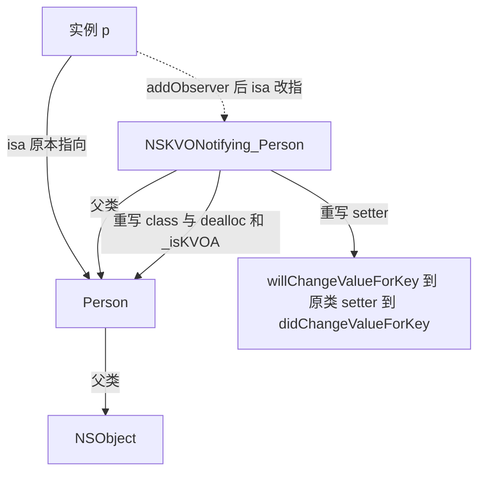

## 起因

之前维护的老工程里有一层字典转模型，实现是 `setValuesForKeysWithDictionary:`。后端加字段没问题，删字段就出事：字典里多出一个模型上没有的 key，直接崩在 `NSUnknownKeyException`。线上堆栈只到 `setValue:forKey:`，看不出为什么。

修这个 bug 顺带把 KVC 的查找顺序和 KVO 的实现机制重新过了一遍，发现平时用得太顺手，反而没认真看过 Foundation 在背后做了哪些事。下面按"怎么用对"和"为什么是这样"两条线记。

## KVC 到底按什么顺序找

`setValue:forKey:` 不是反射字段，它是按命名约定一级级试。以 `setName:` 为例，key 是 `name`：

| 阶段 | setter 查找顺序 | getter 查找顺序 |
| --- | --- | --- |
| 找方法 | `setName:` | `getName` |
| 找方法 | `_setName:` | `name` |
| 找方法 | — | `isName` |
| 找成员变量 | `_name` | `_name` |
| 找成员变量 | `isName` | `isName` |
| 找成员变量 | `name` | — |
| 兜底 | `setValue:forUndefinedKey:` | `valueForUndefinedKey:` |

中间那一步"找成员变量"有个开关：`+accessInstanceVariablesDirectly`，返回 `NO` 就跳过直接访问 ivar 的环节，只走方法。默认是 `YES`。线上那次崩溃就发生在兜底那一行——`setValue:forUndefinedKey:` 的默认实现会先调 `setUndefinedValue:forKey:`，然后抛异常。

所以字典转模型的兜底不该去 catch 异常，而是重写那个空实现：

```objective-c
@implementation DSSTransformableModel

// 多余的 key 静默丢掉，缺字段时保持属性默认值
- (void)setUndefinedValue:(id)value forKey:(NSString *)key {
#ifdef DEBUG
    NSLog(@"[KVC] 模型 %@ 上没有 key %@", NSStringFromClass([self class]), key);
#endif
}

// 数字类型传 nil 时不会走到 setUndefinedValue:，而是这里
- (void)setNilValueForKey:(NSString *)key {
    NSLog(@"key %@ 是标量，收到 nil", key);
}

- (void)setValuesWithDictionary:(NSDictionary *)dict {
    // 先过一遍已知 key，避免把非字符串 value 直接塞给标量属性
    NSMutableDictionary *safe = [NSMutableDictionary dictionaryWithCapacity:dict.count];
    [dict enumerateKeysAndObjectsUsingBlock:^(id k, id obj, BOOL *stop) {
        safe[k] = (obj == [NSNull null]) ? @"" : obj;
    }];
    [self setValuesForKeysWithDictionary:safe];
}

@end
```

两个容易踩的地方：`NSNumber` 之外的对象赋给 `int`/`BOOL` 这类标量会抛异常，走的是 `setNilValueForKey:` 那条路（传 nil 时）而不是 `setUndefinedValue:forKey:`；key 以下划线开头时，KVC 会认为你想直接访问 ivar，规则不一样。

`valueForKeyPath:` 支持 `a.b.c` 逐级取值，中间遇到 `NSNull` 或找不到会继续往下传，最后返回 nil 而不是崩。容器上还有便捷语义：对 `NSArray` 直接 `valueForKey:@"name"`，它会把这个方法广播给每个元素，返回一个装满了 `name` 的数组；`@count`、`@sum`、`@avg`、`@min`、`@max`、`@distinctUnionOfObjects` 这些聚合运算符也是同一套机制，写统计代码时能省掉一层循环。

## KVO 的观察者是谁

`addObserver:forKeyPath:options:context:` 之后，对象的类变了。Foundation 在运行时造了个动态子类，命名规则是原类名前拼上 `NSKVONotifying_`，然后把这个实例的 `isa` 指针指过去——这就是 isa-swizzling。

```plaintext
(lldb) po [p class]
Person                       // 看起来没变，因为 class 方法被重写过
(lldb) po object_getClass(p)
NSKVONotifying_Person        // 真实的 isa 指向
(lldb) po class_getName([p superclass])
Person                       // 动态子类的父类就是原类
```

动态子类里重写了四样东西：被观察 keyPath 对应的 setter、对应的 getter、`class`、`dealloc`，外加一个 `_isKVOA` 标记方法。重写 `class` 是为了不破坏外部逻辑，让 `[p class]` 和 `isKindOfClass:` 表现得跟没被观察一样，这也是为什么很多人发现不了自己 objects 被换了类。真正要看真实类，只能用 `object_getClass` 或 `class_getName`。



setter 被重写成三段式：先 `willChangeValueForKey:`，再调父类（也就是原类）的实现把值真正写进去，最后 `didChangeValueForKey:`。真正给观察者发 `observeValueForKeyPath:ofObject:change:context:` 的是 `didChange` 那一步，它会去查这张 keyPath 上的注册表。所以只要绕过 setter 直接改 ivar（`_age = 30;`），通知就不会发出去——不是 KVO 失灵，是它本来就挂在 setter 上。`change` 字典里的 `NSKeyValueChangeOldKey`、`NSKeyValueChangeNewKey` 也取决于注册时给的 options，没给 `NSKeyValueChangeOldKey` 却去取 old，拿到的是空。

Foundation 在 setter 里插的其实是 `_NSSetIntValueAndNotify` 这类私有辅助函数，不同标量类型对应不同后缀，看汇编时别被绕住。

## 手动通知与几个必须守的规矩

自定义的派生属性（比如 `fullName` 依赖 `firstName` 和 `lastName`）默认不会自动通知，两种做法：重写 `+keyPathsForValuesAffectingValueForKey:` 声明依赖，或者关掉自动通知自己手动来。

```objective-c
@implementation Person

// 命名规则固定：automaticallyNotifiesObserversOf 拼上首字母大写的 key
+ (BOOL)automaticallyNotifiesObserversOfAge {
    return NO;
}

- (void)setAge:(int)age {
    if (_age == age) { return; }
    [self willChangeValueForKey:@"age"];
    _age = age;                       // 绕过 setter 递归，直接写 ivar
    [self didChangeValueForKey:@"age"];   // 通知在这一步发出
}

@end
```

手动配对不能只记一半：只写 `willChange` 不写 `didChange`，观察者收不到通知；反过来只写 `didChange`，某些系统控件（比如绑定的 label）会因为状态没闭合而不刷新。`willChangeValueForKey:` 里的 key 必须和注册的 keyPath 一致，写错了等于没通知。

| 做法 | 结果 |
| --- | --- |
| 直接给 `_age` 赋值 | 不触发通知（没走 setter） |
| 只调 `willChangeValueForKey:` | 不触发通知，且状态不闭合 |
| 手动写 `_age` 加 will/did 配对 | 正常触发，是最省心的手动写法 |
| `setValue:@30 forKey:@"age"` | 触发，KVC 会走被重写的 setter |
| 移除未注册的 observer | 抛异常，崩溃 |
| 同一 observer 同一 keyPath 注册两次 | 收到两次通知，必须移除两次 |

移除这块是崩溃重灾区。稳妥办法是注册时带上一个静态的 context 指针，回调里先比 context 再处理，同时在初始化时记一个 `BOOL didObserve`，`dealloc` 里按它决定要不要 remove。用 block 版 API（`observeValueForKeyPath:` 的封装或 `NSKeyValueObserving` 的 block 形式）能少写一半样板，但 token 必须持有并在合适时机释放，否则观察者比被观察对象活得久。

Swift 侧要注意属性的可见性。Swift 类里的属性默认不进 Objective-C runtime，`observe(_:options:changeHandler:)` 那套 `NSKeyValueObservation` 要求属性同时带 `@objc` 和 `dynamic`，只写 `@objc` 观察不到变化，因为 setter 在编译期就被静态派发了，Foundation 没有机会替换它。

```swift
class Person: NSObject {
    // dynamic 是必须的，否则 KVO 观察不到 setter 调用
    @objc dynamic var age: Int = 0
}

// 观察方持有返回值，返回值释放即停止观察
private var observation: NSKeyValueObservation?

override func viewDidLoad() {
    super.viewDidLoad()
    observation = person.observe(\.age, options: [.new, .old]) { target, change in
        print("age \(String(describing: change.oldValue)) -> \(String(describing: change.newValue))")
    }
}
```

## 小结

KVC 的价值在解耦：给不该暴露 setter 的对象赋值、跨层级取值、对集合做聚合。代价是编译期没有任何检查，key 写错只能运行时崩，所以 keyPath 字符串在工程里最好集中成常量。

KVO 的理解成本主要在 isa-swizzling。知道"实例的类被换成了 `NSKVONotifying_` 开头的动态子类，setter 被重写成 will、原实现、did 三段"，剩下的行为——绕过 setter 不通知、`class` 看起来没变、注册和移除必须对称——都只是这个事实的推论。现在我对它的态度是能不用就不用，跨模块的状态同步更倾向用显式回调或通知，KVO 留给必须观察第三方类属性的场合。
