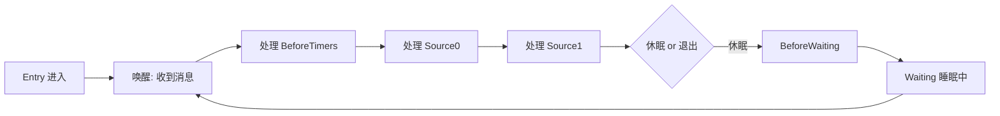

# RunLoop 实战：卡顿监控、线程保活与那些 Mode 坑

RunLoop 是面试八股里的常客，实际工作里却常被当成黑盒。直到要解决三个具体问题——线上卡顿没数据、后台线程总睡死、滚动时定时器罢工——才把它真正掰开看。这篇不谈"RunLoop 是什么"，只讲拿它干过的三件事。

## 先补一张够用就好的地图

RunLoop 本质是个 do-while 循环：没活干就睡眠，有输入源或定时器就唤醒处理。Observer 可以订阅它每个状态流转：



监听 BeforeWaiting 和 AfterWaiting 两个点，就能算出"RunLoop 两次唤醒之间睡了多久、处理任务花了多久"——这是卡顿监控的原材料。

## 实战一：主线程卡顿监控

原理一句话：**子线程高频检查主线程的"处理耗时"，超阈值就抓主线程栈**。

```objective-c
// 1. 主线程注册 Observer，通知计数器归零
CFRunLoopObserverRef observer = CFRunLoopObserverCreateWithHandler(
    kCFAllocatorDefault,
    kCFRunLoopEntry | kCFRunLoopBeforeWaiting,  // 进循环/准备睡，都算"活着"
    true, 0,
    ^(CFRunLoopObserverRef o, CFRunLoopActivity act) {
        atomic_store(&aliveFlag, act == kCFRunLoopBeforeWaiting ? 1 : 0);
    });
CFRunLoopAddObserver(CFRunLoopGetMain(), observer, kCFRunLoopCommonModes);

// 2. 监控线程：每 0.1s 看一次，flag 连续 3 秒没翻过 → 卡顿，立即抓主线程栈
while (monitoring) {
    usleep(100 * 1000);
    if (atomic_load(&aliveFlag) == 0 && ++count >= 30) {
        [self dumpMainThreadStack];  // 用 thread_get_all_logs 或 backtrace
        count = 0;
    }
}
```

三个工程细节：阈值别一刀切，冷启动/页面切换后头两秒豁免；抓栈频率限流，否则卡顿高峰反而把 App 卡死；上报时带上当前页面标识，否则拿到一万个同构的 `main+12` 栈毫无价值。上线后它抓到过最典型的问题：主线程同步读一个 3MB 的 UserDefaults 级别的大 JSON。

## 实战二：NSTimer 在滚动时罢工

滚动时 Timer 不走，老 iOS 同学都知道解法是加到 `CommonModes`：

```objective-c
// ❌ 默认只挂 DefaultModes，滚动(UITrackingRunLoopMode)时休眠
[NSTimer scheduledTimerWithTimeInterval:0.1 target:self ...];

// ✅ 手动加入 CommonModes
NSTimer *t = [NSTimer timerWithTimeInterval:0.1 target:self ... repeats:true];
[[NSRunLoop currentRunLoop] addTimer:t forMode:NSRunLoopCommonModes];
```

但这里有个更隐蔽的坑：**CommonModes 是一个"模式集合"，而 UITrackingRunLoopMode 不在默认集合里**——给滚动场景用的是 `NSRunLoopCommonModes` 注册 Timer 之所以生效，是 UIKit 在运行时往 Common 集合里塞了 tracking mode。自己创建的模式想进 CommonModes 用 `CFRunLoopAddCommonMode`，别指望名字里有 Common 就无处不在。

## 实战三：后台线程保活

需求：一个常驻的后台任务线程，串行处理埋点上报，闲时必须活着。GCD 的串行队列没有"当前队列的 RunLoop"，裸起 `NSThread` 一执行完就退出。标准姿势是手动给线程挂个永不触发的事件源：

```objective-c
- (void)keepAliveEntry {
    NSRunLoop *rl = [NSRunLoop currentRunLoop];
    // 挂一个占位的 port source，RunLoop 有了输入源就不会退出
    CFRunLoopSourceRef src = CFMachPortCreateWithPort(
        kCFAllocatorDefault, 0, NULL, NULL, NULL);
    CFRunLoopAddSource(CFRunLoopGetCurrent(), src, kCFRunLoopDefaultMode);
    [rl addPort:[NSMachPort port] forMode:NSDefaultRunLoopMode]; // OC 层同理
    while (self.alive) {
        [rl runMode:NSDefaultRunLoopMode beforeDate:[NSDate distantFuture]];
    }
    // alive 置 false 后循环退出，线程自然回收
}
```

注意用 `runMode:beforeDate:` 而不是 `run`——后者永不返回，线程没有退出通道，最后只能靠 cancel 强杀。这套结构后来成了埋点线程和 WebSocket 心跳线程的底座（后者还需要在 Source1 回调里驱动 socket 读写事件）。

## 小结

| 场景 | 用的机制 | 关键细节 |
|---|---|---|
| 卡顿监控 | Observer 订阅状态流转 | 抓栈限流、冷启动豁免 |
| 滚动定时器 | CFRunLoopAddCommonMode | UITracking 是 UIKit 偷偷加进集合的 |
| 线程保活 | 占位 Source + runMode: | 必须留 alive 开关，别用 run |

RunLoop 的知识面很宽，但工作里 90% 的用法就是这三件事。把"睡眠-唤醒"这条循环线想清楚，其余都是变体。
