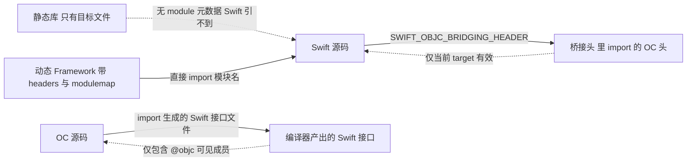

## 混编只有两条路，方向还不一样

Swift 要看 OC，走桥接头文件。Xcode 在往 OC target 里加第一个 Swift 文件时会提示创建，本质是一个普通的 OC 头文件，编译期被塞进 Swift 的编译器前端，构建设置对应 `SWIFT_OBJC_BRIDGING_HEADER`。

OC 要看 Swift，走编译器生成的接口文件，名字是模块名拼 `-Swift.h`。这个文件不在磁盘上，是编译中途生成再喂给 OC 编译器的，所以第一次写 `#import` 时报红、Clean 之后又正常，不用怀疑人生。

两条通道不对称，导致最常见的两个错误都很固定。一是桥接头只在当前 target 内生效：单元测试 target、Widget 扩展各配各的，主工程配好了不等于别的 target 能看见，报错形式是 Swift 侧找不到某个 OC 类。二是循环依赖：桥接头里 import 了某个 OC 头文件，那个头文件又去 import `-Swift.h`，编译器直接罢工。规矩很简单——OC 的头文件里一律用 `@class` 前向声明，把 `-Swift.h` 的 import 放到 `.m` 里。

```objective-c
// DSSUploadService.h —— 被桥接头 import，绝对不能出现 -Swift.h
@class DSSUploadTask;          // 前向声明足够编译器处理指针
@class DSSUser;

@interface DSSUploadService : NSObject
@property (nonatomic, copy, readonly) NSArray *tasks;
- (void)enqueueTaskForUser:(DSSUser *)user completion:(void (^)(BOOL success))block;
@end

// DSSUploadService.m —— 需要真实类型时再 import 生成接口
#import "DSSUploadService.h"
#import "MyApp-Swift.h"

@implementation DSSUploadService

- (void)enqueueTaskForUser:(DSSUser *)user completion:(void (^)(BOOL))block {
    DSSUploadTask *task = [[DSSUploadTask alloc] initWithUserId:user.uid];
    [self.tasks addObject:task];
    if (block) { block(YES); }
}

@end
```

只有带 `@objc` 的东西会出现在 `-Swift.h` 里。裸的 Swift 类、结构体、枚举带关联值的、泛型类型、全局函数、元组、带关联类型的协议，OC 一概看不见。想让整个类可见就打 `@objcMembers`，只暴露个别成员就逐个标。

```swift
// 导出给 OC 时换个符合工程前缀的名字，避免和 OC 侧同名类撞
@objc(DSSUserSession)
@objcMembers
final class UserSession: NSObject {
    var uid: String = ""
    // weak 要求协议约束到类类型，OC 侧才是一个正常的 delegate
    weak var delegate: UserSessionDelegate?

    func markRead(_ ids: [String]) {
        store.markRead(ids)
    }
}

// 只能被类实现，OC 里的 delegate 写法才成立
@objc protocol UserSessionDelegate: AnyObject {
    optional func sessionDidExpire(_ session: UserSession)
}
```

## 名字是第二道墙

OC 的符号是 C 风格的扁平符号，方法派发靠 runtime 里的 selector 表。Swift 有自己的 name mangling，Swift 4 之后符号以 `$s` 开头，更早的产物是 `_Tt` 开头，里面编码了模块名、类型、泛型参数。这意味着 Swift 方法默认不进 Objective-C runtime 的方法列表——`performSelector:`、KVC、KVO、method swizzling 全都找不到它。加 `@objc` 的作用是生成一个 runtime 可见的 thunk 和对应 selector，这也是为什么在 Swift 类上做 swizzle 或者 KVO 观察，经常要补一个 `dynamic`。

排查这类"方法明明写了却调不到"的问题，看符号比猜快。

```bash
# 1. 类有没有真的被链接进来
nm -gU MyApp.app/MyApp | grep -i UserSession | head

# 2. 方法有没有进 Objective-C 的方法表（没标 @objc 的方法这里搜不到）
otool -oV MyApp.app/MyApp | grep -A1 'name.*markOne'
# ---> name   0x221 L_selector_data(markOne:) markOne:
# ---> imp    0x2c _$s5MyApp11UserSessionC7markOneyySSFTo

# 3. mangled 名字还原成可读声明
xcrun swift-demangle '$s5MyApp11UserSessionC7markOneyySSF'
# ---> MyApp.UserSession.markOne(Swift.String) -> ()
```

第 2 步的输出里，imp 那个符号末尾多了 `To`。这就是 `@objc` 做的事情的物证：编译器给 Swift 方法额外生成一个转接用的 thunk，把它挂进 Objective-C 的方法表，selector 是 `markOne:`，实现仍然走 Swift 那份代码。同一个类里没标 `@objc` 的方法，在这个表里一行都看不到——所以 swizzle 和 `performSelector:` 找不到它们，不是时机问题，是根本没登记。

改名工具记两个：Swift 侧写 `@objc(DSSUserSession)` 决定 OC 里叫什么，OC 侧写 `NS_SWIFT_NAME(...)` 决定 Swift 里叫什么。工程前缀不统一的团队建议把这两处写进 code review 清单，否则同一个类在两边是两个名字，检索代码很痛苦。

模块名还会影响生成头文件的文件名。`PRODUCT_MODULE_NAME` 里有连字符或其他非法字符时，Xcode 会把它们替换成下划线，于是 `My-App-Swift.h` 是不存在的，实际要 import 的是 `My_App-Swift.h`。这个坑踩过一次，症状是接口文件明明生成了却 import 不到。

## 类型边界

| Swift 构造 | OC 侧表现 | 处理办法 |
| --- | --- | --- |
| 继承 NSObject 的 class | 直接可见 | 无 |
| struct、enum 带关联值、泛型类 | 不可见 | 换成 class，或包一层 @objc 壳 |
| 全局函数、扩展里的计算属性 | 不可见 | 挪进 @objcMembers 的类 |
| String 对 NSString | 自动桥接，但语义不同 | Swift 侧非可选参数遇到 OC 传 nil 会崩 |
| Int 对 NSInteger | 平台宽度一致 | 32 位设备上都是 32 位，注意手工截断 |
| Array 对 NSArray | 只读方向可桥接 | 传过去的是不可变副本，别指望双向同步 |
| 未标 nullability 的 OC 头 | Swift 里变成隐式解包 | 补 nullability 宏，或改头文件 |
| NSError 双指针出参 | 自动变 throws | 保留原签名即可，Swift 侧 do-catch |
| NS_ENUM / NS_OPTIONS | 变 Swift enum / OptionSet | OC 传未定义值会让 Swift 侧 trap |

最容易被忽视的是倒数第三行。老工程的 OC 头文件没写 `NS_ASSUME_NONNULL_BEGIN` 和 `nullable`，导入 Swift 后参数类型全是隐式解包可选，编译器不强制判空，nil 一路传到业务里才崩。补 nullability 是个体力活，但收益是所有调用点的空安全都变明显，值得排期做。

## Framework 和静态库不是一回事

静态库 `.a` 里只有目标文件，没有 module 元数据，也没有 `-Swift.h`。OC 代码放静态库没问题，Swift 想 `import` 就得自己补 modulemap，且这个库里的 Swift 对外接口不会随产物一起交付，外部 target 拿不到。

```plaintext
// 手工 modulemap 的最小形态，配合 DEFINES_MODULE = YES
module MyLib {
    header "MyLib.h"
    export *
}
```

静态库还有那个经典问题：里面的 Objective-C category 没被链接进来，运行时 `unrecognized selector`。解决办法是加 `-ObjC`，实在不行 `-force_load` 指定路径。动态 framework 不存在这个问题，因为 dyld 在启动时会完整加载镜像并注册类与分类。所以同一个 pod，切到 `use_frameworks!` 就好了、静态集成就崩，多半是这个原因，而不是什么玄学。

代价方面，动态库换来的是启动期加载成本（dyld 阶段多几个镜像），静态库省了这一步但把复杂度留给了集成期。含 Swift 代码的库我更倾向 framework 或 XCFramework：Swift 的模块接口文件（`.swiftinterface`）只有随框架交付，跨 Swift 版本、跨平台的二进制分发才走得通。CocoaPods 集成混编库时留意 `use_modular_headers!`，否则 Swift 侧 import 不到那些只有裸头文件的 OC pod。

两边同名类是另一类链接期事故：静态库里的 `DSSLogger` 和主工程里的 `DSSLogger` 同时存在，轻则 `duplicate class` 警告，重则运行时加载到"错的那个"，表现是某个方法行为不对。混编工程里我要求新类必须带统一前缀，Swift 侧虽然靠模块隔离，一旦加了 `@objc(Name)` 就回到了全局命名空间，前缀规矩不能松。



## 小结

落到工程里是五条：桥接头只放基础且无环的头文件；OC 头文件用前向声明，生成接口只在实现里 import；对外 API 的导出名两边都过一遍；老 OC 头补 nullability；含 Swift 的库优先 framework 或 XCFramework，静态集成就要把 `-ObjC` 和 modulemap 写进集成文档。

混编本身不难，难在两边的类型系统和编译模型不一致，而编译器不会在每个出错点都给你清晰的提示。把规矩定死之后，剩下的问题基本都是看符号、看构建日志能解决的。
