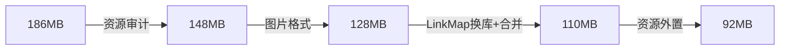

# iOS 包体积瘦身实战：从 186MB 到 92MB

商店页上"186 MB"这个数字挂了很久——用户看到就劝退一半，下载失败率、首装转化都在悄悄挨刀。上个月终于排上期把包体积瘦下来，最终 186MB 降到 92MB，过程里踩的坑比冷启动那篇还多，记录一下完整打法。

## 先搞清楚包里有哪几类东西

App Store 显示的下载体积和真机安装体积是两回事，优化前先用 Xcode 的 Report Navigator 看 App Store App Size 报告，把构成拆出来：

```plaintext
IPA 包
  ├─ 可执行文件（__TEXT 代码 + __DATA + 常量）     ← 通常 15~25MB
  ├─ 资源（图片/字体/音频/json）                    ← 大头，常占 60% 以上
  ├─ Frameworks（内嵌动态库）
  └─ 其他（插件、bundle、模型文件）
```

经验规律：**八成项目的体积问题在资源，不在代码**。先量再切，别上来就动工程配置。

## 第一刀：资源审计（收益最大）

把 ipa 解压，按目录聚合大小排序，问题一眼可见：

```bash
unzip -q Payload/MyApp.app -d /tmp/app_check
du -m /tmp/app_check/MyApp.app | sort -rn | head -20
# 找出重复文件（哈希比对）
find /tmp/app_check/MyApp.app -type f -exec md5 {} \; | sort | uniq -d -w 32
```

我们查出来的三类问题：

| 问题 | 实例 | 处理 |
|---|---|---|
| 同一张图多份拷贝 | 5 个模块各带一份 2.1MB 的运营图 | 下沉公共库，只留一份 |
| 设计切图直接进包 | @3x PNG 未压缩，单张 400KB+ | PNGQuant 有损压缩（肉眼无差，平均省 60%） |
| 死资源 | 活动下线两年，图还在包里 | 建清单删包，见下文 |

死资源扫描比想象中容易踩坑：图片名可能来自服务端下发的字符串，静态扫描删了直接线上 crash。稳妥做法是**两段式**——先用脚本扫出"代码里零引用"的候选名单，再结合运行时打点：线上版本给资源加载埋一个按文件名的计数器，跑两个版本周期确认某资源真实加载次数为零，下个版本再删。

## 第二刀：图片格式与加载策略

PNG 给 UI 素材、JPEG 给照片是十年前的规矩了。现在的合理姿势：

```objective-c
// 照片类资源统一转 HEIC（解码仍走 ImageIO，无需第三方）
// 网络图统一 WebP，SDWebImage 5.x 自带解码器
// Asset Catalog 放的图片 Xcode 会按机型/App Thinning 生成优化版本，
// 优先用 xcassets 而不是 loose file —— App Thinning 只对前者生效
```

App Thinning（按分辨率只下发所需 @2x/@3x）在构建产物看不出来，只在商店下载端生效，所以验证瘦身效果要看商店报告的下载大小，不能只看本地 ipa。

## 第三刀：可执行文件与二进制

代码段的优化空间小但值得做：

**dead code 剥离。** Build Settings 里确认 `DEAD_CODE_STRIPPING = YES`（默认开，但被 static library 传递依赖污染过的项目常常失效），配合 `-O3` 和 LTO（Link Time Optimization）能再抠几个 MB。代价是链接时间变长，CI 上感受明显。

**LinkMap 分析。** 开 `Write Link Map File`，产物是个几百万行的文本，直接看没意义，聚合脚本走起：

```python
# linkmap_summary.py —— 按库聚合符号体积，找出最胖的依赖
import collections, re, sys
size = collections.Counter()
for line in open(sys.argv[1]):
    m = re.match(r"^\s*\d+\s+\d+\s+0x[0-9A-Fa-f]+\s+(\S+)", line)
    if m:
        size[m.group(1).split(".a(")[0]] += int(line.split()[1])
for lib, s in size.most_common(15):
    print(f"{s/1024/1024:8.2f} MB  {lib}")
```

跑完我们发现一个三方统计 SDK 带着 14MB 的静态库，而实际只用它三个上报接口——最后用"自己封装 50 行网络上报"换掉了它。这类决策 LinkMap 给不了，是分析结果逼出来的。

**动态库合并。** 内嵌 framework 每个都有对齐 padding，十几个小组件库不如合并成一个。我们 12 个合并到 4 个，光对齐浪费就省了 3MB 多。

## 第四刀：把大资源搬出主包

活动素材包、语音包、地图数据这类"不是首屏必需"的资源，两条路：老工程用 On-Demand Resources（苹果托管，按 tag 按需下载）或者自建 CDN 资源热更框架；新项目直接上 App Clips 的分层思路——主包只留启动必需，其余按需拉取。这一步把 30 多 MB 的活动资源移出主包，是最终从 110 到 92 的关键。

## 成果与教训



两条教训值得单独说。一是**没有门禁的瘦身都是暂时瘦身**——我们把包体积做进了 CI：每次合主干对比基线，增量超 500KB 必须审批，装包环节加 `du` 阈值告警。二是**删资源要留观察期**，我们第一版激进脚本删掉一张"零引用"的引导图，上线后运营活动配置中心下发同名 key，用户白屏十分钟。运行时打点确认零加载，才是删除的唯一凭据。
