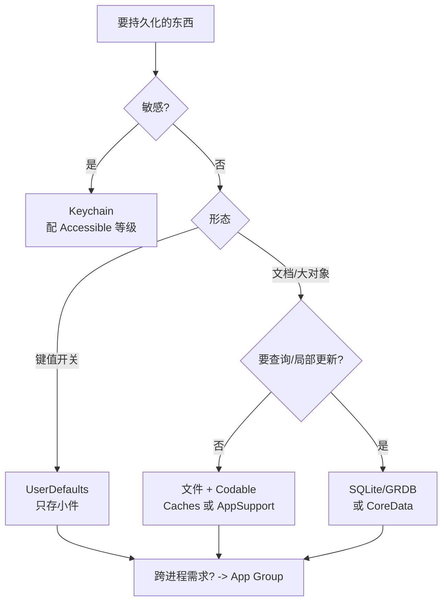

# iOS 数据持久化选型：从 UserDefaults 到数据库的那条线

"这个数据存哪"是 iOS 工程里出现频率最高的日常决策之一。存 UserDefaults 的、把 JSON 扔 Documents 的、CoreData 建了又删的，我在项目里都见过——而且常见组合是：一个 App 里五种方案并存，没有一条选型标准。这篇把持久化的选型线画清楚。

## 先给决策表

| 场景 | 方案 | 关键理由 |
|---|---|---|
| 用户偏好/开关（<几KB） | UserDefaults | 同步读、简单，但注意下面第三节 |
| 密钥/令牌 | Keychain | 加密、备份可控、删 App 可留 |
| 单一大对象缓存（接口结果） | 文件 + Codable（Caches 目录） | 可整体失效、不进备份 |
| 结构化业务数据、要查询 | GRDB（SQLite）或 CoreData | 索引、事务、分页 |
| 大量小对象频繁读写 | SQLite 系，别用 plist | 单文件全量读写的代价见第三节 |
| 跨进程/App 小组件共享 | App Group + 文件或 SQLite | 沙盒边界决定 |

一句话版本：**键值上 UserDefaults，敏感上 Keychain，文档走文件，数据进数据库。**

## 沙盒目录：第一道考试题

文件放哪个目录，决定它是否进 iCloud 备份、是否可被系统清理：

```plaintext
App Sandbox
├─ Documents/     用户生成内容 —— 会备份，别塞缓存
├─ Library/Caches/ 缓存 —— 不备份，磁盘紧张时可被清
├─ Library/Application Support/  需要持久且不想被备份的
└─ tmp/            即用即弃，随时可能没
```

最常犯的错：把下载的运营资源放 Documents。后果有二：iCloud 备份爆炸触发用户投诉，以及"系统备份慢"的锅莫名背在身。正确姿势是缓存类资源放 Caches，并在 `applicationDidReceiveMemoryWarning` 或磁盘水位告警时能安全重建——**Caches 的契约就是"删了还能活"**。

## UserDefaults 的隐形账单

UserDefaults 读写是 plist 全量解析。存 5 个开关没事；把接口缓存、首页配置往里塞，到几万 key 或几 MB 时，`object(forKey:)` 的同步读会在主线程触发整文件解码——线上卡顿监控抓到过这种"莫名卡一下"。三条纪律：

1. **只存键值，不存数据**：大于几十 KB 的东西一律落文件；
2. **读操作离开主线程**，或启动预热一次进内存；
3. **敏感信息永不入**：UserDefaults 是明文，越狱机上等于公开。

```objective-c
// 反面教材（真实事故原型）：把接口 JSON 字符串塞 UserDefaults
[[NSUserDefaults standardUserDefaults] setObject:jsonString forKey:@"home_cache"];
// 首页配置 200KB，冷启动主线程读它 → 解码 40ms，低端机翻倍
```

## Keychain 的三个认知修正

**一，它不是保险箱是信封。** Keychain 加密强度依赖设备解锁状态，`kSecAttrAccessible` 才是关键配置：令牌类用 `kSecAttrAccessibleAfterFirstUnlock`（重启后首次解锁前不可读，但推送里要用的除外），密码类用 `kSecAttrAccessibleWhenPasscodeSetThisDeviceOnly`。默认值不是最安全的，别裸用。

**二，备份行为要显式管。** `kSecUseDataProtectionKeychain`(iOS 13+) 与 `dataProtectionKeychain` 相关配置会影响跨设备同步，不想让令牌跟到用户新 iPhone 上，就设 `kSecAttrSynchronizable` 为 false 并确认备份选项。

**三，删 App 不一定删 Keychain。** 这是特性也是坑：卸载重装后"登录态复活"，测试同学报的 bug"退出登录没生效"多半是这个。需要严格生命周期管理的业务，在登出流程里显式清 Keychain。

## 数据库这一档：什么时候值得

"数据超过 1000 条、需要条件查询、需要局部更新"，三条占两条就该上 SQLite 系。CoreData 还是 GRDB(FMDB 后继思路)？我的实践口径：

- 查询形态复杂、性能敏感、团队能驾驭裸 SQL → GRDB：迁移脚本显式可控，没有 CoreData 的"黑盒 magic"；
- 对象图管理刚需（关系、撤销、iCloud 同步）→ CoreData；
- 只有本地缓存诉求 → Codable + 文件也可能比上数据库省半个月工期，别过度工程。

```swift
// GRDB: 分页 + 索引，2 万条评论的首屏查询 <5ms
try dbQueue.read { db in
    try Comment
        .filter(Column("item_id") == itemId)
        .order(Column("created_at").desc)
        .limit(20, offset: 0)
        .fetchAll(db)
}
// 前提是建了索引：
// CREATE INDEX idx_comment_item ON comment(item_id, created_at DESC);
```

## 一图总装



持久化选型的本质是**按数据的生命周期和访问形态分类，再按沙盒规则放对位置**。方案没有高低，放错位置才是——把接口缓存塞进 UserDefaults、把用户照片存进 Caches，每一个"错位"都是未来的线上事故或用户投诉。选型线画在前面，返工就省在后面。
