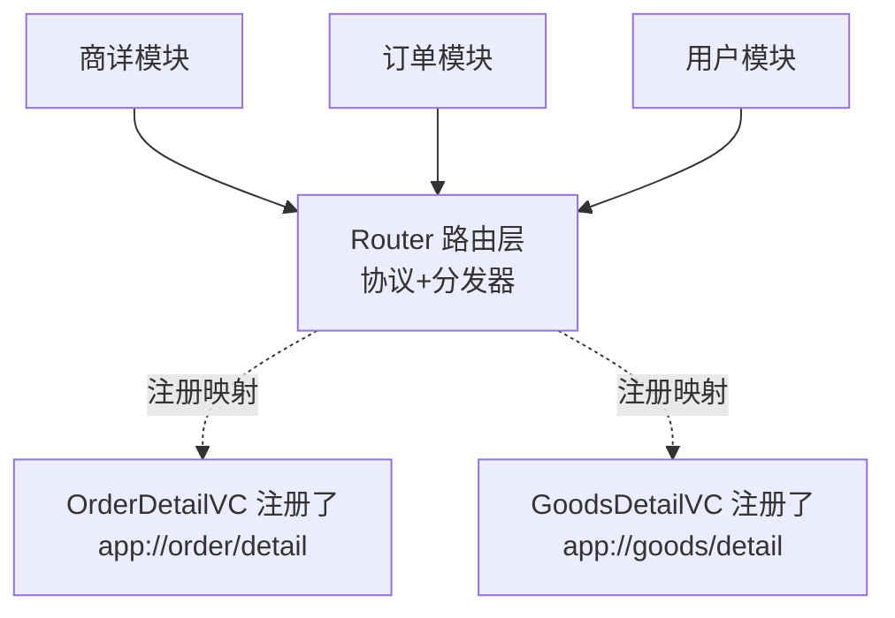

# iOS 组件化路由实战：从 if-else 跳转泥潭到 URL 协议

老工程长到一定规模，第一个崩掉的往往不是性能，是"跳转"：A 业务要跳 B 业务的详情页，最直接的办法是 import B 的控制器——于是依赖网越织越密，最后所有模块互相引用，编译一个文件全工程重编，改一行代码三个组来打群架。组件化改造的说明书里，路由是那颗最关键的螺丝。这篇记录我们给老工程装这颗螺丝的全过程。

## 目标状态：业务之间只说"地址"，不见"人"

组件化的核心纪律一句话：**业务模块之间不允许直接持有对方的类**。跳转要变成这样：

```objective-c
// 业务方视角：我只知道"要去哪"，不知道"谁负责"
[[DaiszRouter shared] openURL:@"app://order/detail?id=20261127001"
                       fromVC:self
                   completion:^(DaiszRouteResult *r) {
    if (!r.success) { [self showToast:@"页面走丢了"]; }
}];
```

`app://order/detail` 是协议，具体由订单模块的某个控制器来响应——这个映射关系登记在路由表里，订单模块内部怎么重构、换不换实现，业务方毫不知情。依赖方向从"互相 import"变成"都依赖路由抽象层"：



## 注册：三段式方案

路由表怎么建立，是方案选型的主战场。三种主流做法我们实测过：

| 方案 | 原理 | 优点 | 致命缺点 |
|---|---|---|---|
| plist/远端配置 | 启动读配置表 | 可动态下发 | 表和代码脱节，改了类名忘改表=线上跳失 |
| `+load` 注册 | 每个 VC 在 load 里注册自己 | 简单直接 | N 个 +load 拖慢冷启动（我们实测 40+ 个 load 多花 180ms） |
| `__DATA` 段扫描 | 宏写入自定义段，启动一次性读 | 零 +load 开销 | 实现门槛稍高，调试不直观 |

最终选了段注册（就是冷启动那篇用过的手法）：

```objective-c
// 注册宏：在 OrderDetailVC.m 顶部写一行
DaiszRouteRegister(@"order/detail", OrderDetailVC)

// 宏展开（简化版）：把 "order/detail,OrderDetailVC" 塞进自定义段
#define DaiszRouteRegister(url, cls) \
    __attribute__((used, section("__DATA,daisz_route"))) \
    static const char *_route_##cls[] = url "," #cls;

// 启动时一次性读出全表，+load 一个不用
unsigned long size = 0;
char *bytes = (char *)getsectiondata(mh, "__DATA", "daisz_route", &size);
// 解析 bytes 按行建表...
```

## 拦截器：路由层的真正价值

有了统一入口，才谈得上统一治理。路由分发前挂一条拦截器链，横切逻辑全部收编：

```objective-c
// 拦截器协议：返回 YES 继续，NO 代表已接管
@protocol DaiszRouteInterceptor <NSObject>
- (BOOL)intercept:(DaiszRouteRequest *)req;
@end

// 上线时链上跑了四个拦截器：
// 1. 登录拦截：需要登录的 URL（表里声明），未登录先拉登录页，
//    登录成功后凭 req 自动续跳 —— 再也没写过"登录回来后页面丢了"
// 2. 灰度拦截：命中灰度策略的 URL 改写目标（旧页 → 新页）
// 3. 降级拦截：未注册的 URL 兜底到 H5 对应页，跳转零丢失
// 4. 埋点拦截：所有跳转自动上报来源页与目标页
```

这四个里性价比最高的是降级拦截：组件化过渡期总有模块没迁完，未注册 URL 自动落到 H5，用户无感知，团队也不用"一把梭全量切换"。

## 参数：从字典到类型安全

路由参数是最容易腐化的地方——`parameters[@"id"]` 取出来是什么类型全凭默契。我们定了两条规矩：**注册时声明参数契约**（哪些必填、什么类型），**分发前校验**，缺参直接失败回调 + 埋点，而不是把 nil 塞进目标页面让它在深处崩。线上跑第一个月，路由层就拦下过 23 次缺参跳转，全是"改了字段名忘了改调用方"，这类问题过去都是 UI 测试都难抓的深坑。

## 改造节奏：绞杀者模式

最后说实施。几百个跳转点不可能一次换完，我们的节奏是"**新增必走路由，存量随改随迁**"：

1. 第一周装好路由层 + 拦截器框架，只转发不强制；
2. CI 加规则：diff 中出现跨模块 import 直接评论警告（新账不再欠）；
3. 存量按"谁改谁迁移"还清；
4. 每季度看跨模块 import 的余量报表，收敛即胜利。

两年后回看，组件化带来的最大红利不是编译变快（也快不了多少），而是**组织边界的澄清**：路由表就是团队间的 API 文档，拦截器是治理抓手，跳转关系第一次变得可观测、可审计。架构改造的价值常常不在技术本身，在它把"人与人怎么协作"这件事，从口头约定变成了代码事实。
