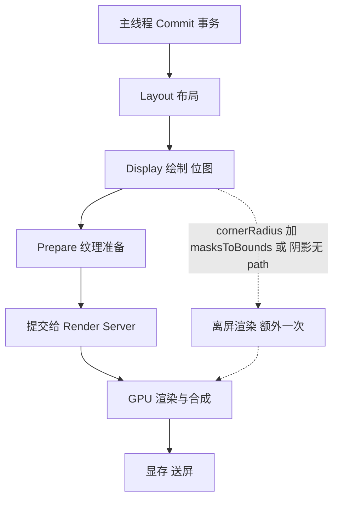

## 现场

项目里的动态列表页，测试报"快速滑动一卡一卡的"。自己上手试，滑起来确实有不连续的顿挫，但 Instruments 里看到的平均帧率是 58.2，很接近 60，单看这个数字完全找不出问题。

后来改成统计每一帧的耗时分布，结论立刻不一样了：中位数 8.4ms 很漂亮，99 分位是 34ms，也就是说每几十帧里就有一帧的耗时超了两倍预算。人眼对这种偶发的长帧特别敏感，平均值反而什么都反映不了。这次优化的起点就是把指标从"平均帧率"换成"frame time 分布"。

预算是死的：60Hz 屏幕一帧 16.67ms，CPU 和 GPU 大致各分一半，主线程真正能用的只有 8ms 多一点。到了 ProMotion 的 120Hz，一帧预算掉到 8.33ms，同一套代码在高刷屏上会明显更抖。

## 先量准，再动手

平均帧率用 CADisplayLink 统计，但要把超预算的帧单独挑出来，光看平均值没意义。

```objective-c
@interface DSSFPSProbe : NSObject
@property (nonatomic, strong) CADisplayLink *link;
@property (nonatomic, assign) NSInteger frameCount;
@property (nonatomic, assign) NSTimeInterval lastTimestamp;
// 每一帧的实际耗时样本，单位 ms，跑完一轮导出做分位统计
@property (nonatomic, strong) NSMutableArray *samples;
@end

@implementation DSSFPSProbe

- (void)tick:(CADisplayLink *)link {
    if (self.lastTimestamp > 0) {
        NSTimeInterval cost = (link.timestamp - self.lastTimestamp) * 1000.0;
        [self.samples addObject:@(cost)];
        // 只打印超预算的帧，方便边滑边看
        if (cost > 20.0) {
            NSLog(@"long frame: %.2f ms", cost);
        }
    }
    self.lastTimestamp = link.timestamp;
    self.frameCount += 1;
}

- (void)exportSummary {
    NSArray *sorted = [self.samples sortedArrayUsingSelector:@selector(compare:)];
    NSInteger n = sorted.count;
    if (n == 0) { return; }
    NSLog(@"median %@  p95 %@  p99 %@",
          sorted[n / 2], sorted[(NSInteger)(n * 0.95)], sorted[(NSInteger)(n * 0.99)]);
}

@end
```

有了长帧的时刻，就知道该在哪个时间窗看 profiler。判断 CPU 瓶颈还是 GPU 瓶颈，我的习惯是两条线一起看：Time Profiler 看主线程在哪个函数上占得多，Core Animation instrument 看 Core Animation 和 Render Server 两条轨道的占用比例。前者高就是布局、绘制、文本计算太重；后者高就去查离屏渲染和过度混合。

模拟器上的 Debug 选项（Color Blended Layers、Color Offscreen-Rendered Yellow）能当粗略的探照灯用，但真机上还是要以 instrument 的数据为准，模拟器的 GPU 行为和真机差得比较远。

一次帧从提交到点亮屏幕，中间是这样：



虚线那条就是"多出来的一次渲染"，代价是额外的显存分配和上下文切换，在 cell 数量多的列表里会被放大几十倍。

## 四个具体问题

头像和卡片都用了 `cornerRadius` 加 `masksToBounds`。这是最典型的离屏渲染组合：layer 有圆角又要裁剪子内容，GPU 没法在帧缓冲上直接画完，必须先在另一块缓冲区里把内容画好、裁好，再合成回来。系统对 `UIImageView`、`UIButton` 这类控件做过一些优化路径，但不能指望它覆盖所有情况，尤其是自己套了一层容器 view 的。

阴影更隐蔽。只设 `shadowColor`、`shadowOffset`、`shadowRadius`，不设 `shadowPath`，GPU 就不知道阴影的形状，只能把内容先渲染一遍，从 alpha 抠出轮廓再模糊，这块必然离屏。

触发条件整理成一张表，页面上按表过一遍就能查出大半：

| 触发条件 | 为什么会离屏 | 处理方式 |
| --- | --- | --- |
| cornerRadius 且 masksToBounds 为 YES | 需先绘制再裁剪，帧缓冲上无法一步完成 | 图片侧预裁切；或用带圆角的可拉伸背景盖边 |
| 设了 shadow 但未设 shadowPath | 阴影轮廓要由内容 alpha 反推 | 用 UIBezierPath 显式给出 shadowPath |
| layer.mask 自定义遮罩 | 遮罩与内容要先各自绘制再相与 | 能用 alpha 通道解决的不用 mask |
| shouldRasterize 为 YES | 光栅化结果本身在离屏缓冲区生成 | 静态内容可用，需正确设 rasterizationScale |
| 组的透明度叠加（group opacity） | 子层要先合成再整体调透明度 | 拆开设置各子层 alpha，减少嵌套透明组 |

## 代码上的处理

圆角我分两种情况。头像这种纯图片，就在子线程把圆角直接画进位图，layer 不再做任何裁剪，代价是一次子线程绘制和一张缓存图；容器类卡片改不了内容形状，就给它设 `shouldRasterize` 并把 `rasterizationScale` 跟上屏幕 scale，内容不变的卡片光栅化缓存能省掉重复绘制。

```objective-c
// 子线程预渲染圆角图，结果按 url 缓存，layer 不再设 cornerRadius
- (void)dss_roundedAvatarWithURL:(NSString *)url
                            size:(CGSize)size
                       completed:(void (^)(UIImage *))done {
    UIImage *cached = [[DSSAvatarCache shared] imageForKey:url];
    if (cached) { done(cached); return; }

    dispatch_async(dispatch_get_global_queue(QOS_CLASS_USER_INITIATED, 0), ^{
        UIImage *origin = [DSSAvatarCache rawImageForKey:url];
        UIGraphicsBeginImageContextWithOptions(size, YES, 0);
        CGContextRef ctx = UIGraphicsGetCurrentContext();
        CGContextAddPath(ctx, [UIBezierPath bezierPathWithRoundedRect:(CGRect){CGPointZero, size}
                                                        cornerRadius:size.width / 2.0].CGPath);
        CGContextClip(ctx);
        [origin drawInRect:(CGRect){CGPointZero, size}];
        UIImage *result = UIGraphicsGetImageFromCurrentImageContext();
        UIGraphicsEndImageContext();

        [[DSSAvatarCache shared] setImage:result forKey:url];
        dispatch_async(dispatch_get_main_queue(), ^{ done(result); });
    });
}
```

阴影统一补 `shadowPath`，路径跟 cell 的 bounds 走，`layoutSubviews` 里更新一次。

```objective-c
- (void)layoutSubviews {
    [super layoutSubviews];
    CGRect bounds = self.cardView.bounds;
    // 给定形状，GPU 不必再从内容反推阴影轮廓
    self.cardView.layer.shadowPath = [UIBezierPath bezierPathWithRoundedRect:bounds
                                                                cornerRadius:10.0].CGPath;
    self.cardView.layer.shadowRadius = 6.0;
    self.cardView.layer.shadowOpacity = 0.12;
    self.cardView.layer.shadowOffset = CGSizeMake(0, 2);
    self.cardView.layer.masksToBounds = NO;   // 裁剪交给路径本身
}
```

高度这块花的时间最多。原先每个 cell 都在 `heightForRowAtIndexPath` 里现算，UITableView 为了确定滚动条比例，还会把这一屏之外的行也问一遍，同一份文本被布局两次。做法很朴素：以数据标识加宽度做 key 缓存高度，算过就查表。

```objective-c
- (CGFloat)tableView:(UITableView *)tableView heightForRowAtIndexPath:(NSIndexPath *)indexPath {
    PostModel *model = self.rows[indexPath.row];
    NSString *key = [NSString stringWithFormat:@"%@-%.0f-%@",
                     model.objectID, tableView.bounds.size.width, model.contentHash];

    NSNumber *cached = self.heightCache[key];
    if (cached) {
        return cached.doubleValue;
    }
    CGFloat height = [self.templateCell sizeHeightForModel:model];
    self.heightCache[key] = @(height);
    return height;
}
```

配套还要把 `estimatedRowHeight` 设上，取一个经验均值就行，别留系统自己估。这个值的作用是决定首次布局时按全量还是按估算来问高度：不给估算值，UITableView 会把所有行的高度和内容尺寸都先问一遍，好算出 `contentSize` 用来画滚动条，行一多就是几百次布局。给一个大致准确的估算值之后，它只精确计算屏幕上和屏幕附近的那几行，其余等滑到再算。估算值和真实值差太远还会引起滚动条跳动，所以取中位数比取平均值好用。数据变化时的失效按 key 覆盖写，不用整表清空——只有下拉刷新才清一次。

key 里带上 `contentHash` 是有原因的。只按 `objectID` 加宽度缓存，遇到同一条数据改了文字（比如审核状态变了、昵称改了）就会拿到旧高度，表现是 cell 底部留一截白或者文字被截。之前线上就有个反馈说"长评论有时只显示三行"，最后查到是缓存 key 里少了内容指纹。

高度之外，文本测量本身也能省。`boundingRectWithSize:options:` 在长文本上并不便宜，一段三百字的富文本走一次要 0.4ms 左右，同一条数据在 `heightForRow` 和 `cellForRow` 各算一次就翻倍。缓存好算一次的结果，配置 cell 时直接取，是笔划算的买卖。同理，`layoutIfNeeded` 在 `cellForRow` 里能不写就不写，那等于把下一帧的布局提前搬到这一帧做。

另外三个小头：`NSDateFormatter` 每次调用都新建，换成按 locale 缓存的单例；cell 里的富文本高度由服务端下发字段带上文字长度，本地算一次进缓存；复用流程里有个 `addSubview` 没做去重，导致子 view 越叠越多，滚动几步之后同一屏有三十多个 label，这个是纯 bug，但只有在 Instruments 的视图层级里才看得出来。图片解码放在主线程也是同类问题，`UIImage` 从磁盘读出来时位图并没有解码，真正解是在 draw 的那一刻，也就是主线程——用异步解码或者提前生成缩略图，能把手感最抖的那几毫秒挪走。

## 复测

同样的路径快速滑动五十秒：p99 从 34ms 降到 12ms，平均帧率 58.2 升到 59.6，肉眼那段顿挫没了。在更老的机器上提升更明显，因为那里 GPU 的余量本来就不多。

## 小结

顺序上我认可这么走：先把帧耗时分布测出来，再分 CPU 还是 GPU，再对着触发表找离屏，最后才动代码。四个改动里收益/成本比最高的是高度缓存，它同时省了主线程布局和系统重复询问的开销；离屏渲染不是洪水猛兽，`shouldRasterize` 本身就是拿一次离屏换多次不绘制，但同一个 cell 每帧都触发一次离屏就是纯粹浪费。

还有条经验值得留着：平均值好看的指标都可能骗人。58.2 帧的列表卡，是因为卡的那几帧根本不在平均值里。
