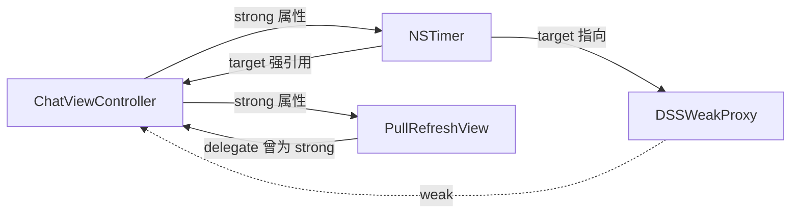

## 现象

之前维护的老工程里有个 IM 会话页，退出之后过一会儿还能在控制台看到心跳日志在打。第一反应是定时器忘了关，可代码里 `viewWillDisappear` 确实调了 `invalidate`。把断点打在 `dealloc` 上，退出页面时根本没进来，说明控制器本身就没被释放——定时器只是被牵连的那个。

页面里可疑的对象就三个：一个 30 秒周期的保活定时器、一个自定义的下拉刷新控件（带 delegate）、两处通知回调。逐个查。

## 定位过程

第一步用 Xcode 的 Memory Graph Debugger。退出页面后点一下调试条上的灰色相机图标，左侧列表里搜 `ChatViewController`，还在。点开这个对象，右侧画布会把它的所有入边（谁持有我）和出边列出来，顺着入边往上点，链路是 `ChatViewController -> NSTimer -> NSRunLoop`，而 timer 的 `_info` 里 target 又指回控制器。环找到了。

光看关系图还不够，我要确认线上是不是同一类问题，所以又跑了一遍 Instruments。这里有个容易搞混的点：Leaks 只报"没有指针指向的对象"，循环引用因为互相指着，引用计数不归零但指针还在，反而经常不进 Leaks 列表，只在旁边留一句 "Possibly leaked object (overhang due to xxx bytes of leak)"。真正管用的是 Allocations 里的 Cycles & Roots 视图，它就是专门把互相引用的对象成组挑出来，每组展开能看到环上的每一个对象和它们之间的引用键名，比肉眼推持有关系快得多。

Generation 适合另一种场景：不确定是哪次进出页面留下的。做法是进页面前点一次 Mark，操作完退出来再点一次 Mark，然后只看这个区间内的 App Memory 增量，把 Responsible Stack 展开，能直接看到分配发生在哪个方法里。判断标准也很朴素：内存只涨不降，而且增量跟进出次数成正比，基本就是环；如果涨的是固定的一坨且不随次数变化，更可能是缓存策略的问题，不是引用问题。

顺便交代一下走过的弯路。一开始怀疑过 cell 复用和图片缓存，因为这个页面列表很长。在 Allocations 的 Category List 里按 By Type 排序，看 Generic Malloc 和 CGImage 的增长曲线，发现它们退出后能回落，说明图片这块是干净的，才把注意力收回到控制器实例本身。这个顺序其实值得记一下：先看"什么类型的内存在涨"，再去找"谁持有它"，比上来就翻代码省时间。

```objective-c
// 问题代码
@interface ChatViewController ()
@property (nonatomic, strong) NSTimer *heartbeatTimer;
@property (nonatomic, strong) PullRefreshView *refreshView;
@end

@implementation ChatViewController

- (void)viewDidLoad {
    [super viewDidLoad];
    self.refreshView.delegate = self;   // PullRefreshView 里 delegate 是 strong
    self.heartbeatTimer = [NSTimer scheduledTimerWithTimeInterval:30.0
                                                           target:self
                                                         selector:@selector(pullHeartbeat)
                                                         userInfo:nil
                                                          repeats:YES];
}

- (void)dealloc {
    // 这里永远不会执行
    [self.heartbeatTimer invalidate];
}
```

## 三处环路分别怎么处理

delegate 写成 strong 是最省事的一个。协议回调天然就是"我通知你，但不拥有你"，一律 `weak`。当年是为了省掉一处 crash 才改成 strong 的，属于把雷埋进地基。

```objective-c
// PullRefreshView.h
@class PullRefreshView;

@protocol PullRefreshViewDelegate
- (void)pullRefreshViewDidTrigger:(PullRefreshView *)view;
@end

@interface PullRefreshView : UIView
// delegate 的类型是 id 加协议约束，这里省掉泛型写法只强调修饰符
// 修复：weak，打断 View -> Controller 这条边
@property (nonatomic, weak) id delegate;
@end
```

NSTimer 这条边打断不了（target 就是强引用），只能换思路。iOS 10 之后可以直接用 block 版本，配合 `weakSelf`；要兼容更老的系统就自己写个转发用的 proxy，timer 持有 proxy，proxy 只 weak 指向控制器。工程里两种都留了，新页面用 block。

```objective-c
// 方案一：block + weak/strong 配对
__weak typeof(self) weakSelf = self;
self.heartbeatTimer = [NSTimer scheduledTimerWithTimeInterval:30.0
                                                      repeats:YES
                                                        block:^(NSTimer *timer) {
    __strong typeof(weakSelf) strongSelf = weakSelf;
    if (strongSelf == nil) {
        [timer invalidate];
        return;
    }
    [strongSelf pullHeartbeat];
}];

// 方案二：中间人 proxy，timer 只认识 proxy
@interface DSSWeakProxy : NSProxy
@property (nonatomic, weak, readonly) id target;
@end

@implementation DSSWeakProxy

+ (instancetype)proxyWithTarget:(id)target {
    DSSWeakProxy *proxy = [DSSWeakProxy alloc];
    proxy->_target = target;
    return proxy;
}

- (NSMethodSignature *)methodSignatureForSelector:(SEL)sel {
    return [self.target methodSignatureForSelector:sel];
}

- (void)forwardInvocation:(NSInvocation *)invocation {
    if ([self.target respondsToSelector:invocation.selector]) {
        [invocation invokeWithTarget:self.target];
    }
}

@end

// 使用：target 传 proxy，环就断了
self.heartbeatTimer = [NSTimer scheduledTimerWithTimeInterval:30.0
                                                       target:[DSSWeakProxy proxyWithTarget:self]
                                                     selector:@selector(pullHeartbeat)
                                                     userInfo:nil
                                                      repeats:YES];
```

这里要提醒两点。一是 block 版本本身不解决问题：timer 依然强引用那个 block，block 里直接写 `self.pullHeartbeat` 照样成环，`weakSelf` 一步都不能省。block 版本的好处只是让"timer 到期"和"self 已释放"这两件事好判断，可以在里面顺手 `invalidate`。二是 proxy 方案有边界：`DSSWeakProxy` 是 NSProxy 不是 NSObject，只转发了消息签名和调用，`isEqual:`、`hash`、`class` 这些如果目标代码会去比对，行为可能不符合预期；而且 KVO 不能观察 proxy，需要观察 timer 内部状态的场景就不适用。所以工程里把 proxy 限定只服务定时器和 display link，别的地方不允许用。

`CADisplayLink` 同理，它也是强持有 target，滚动动画里更常见，别忘了它的 `invalidate`。有个细节：display link 默认挂在主 runloop 的 common modes 上，如果手动只加到 `NSDefaultRunLoopMode`，滚动时会被切掉，表现是"动画在滑动时停住"，这是另一个话题，但排查时经常和内存问题混在一起看到。

通知只踩了半个坑：`addObserver:selector:` 这种老写法是不持有 observer 的（iOS 9 之后还能自动移除），真正会成环的是 block 版本——token 被 self 持有，block 又捕获了 self。改成 block 前先想清楚 token 存哪。

```objective-c
// 这样写会成环：token 被 self 强持有，block 又捕获 self
self.msgToken = [[NSNotificationCenter defaultCenter]
    addObserverForName:@"DidReceiveMessage"
                object:nil
                 queue:[NSOperationQueue mainQueue]
            usingBlock:^(NSNotification *note) {
    [self reloadLastRow];
}];

// 加一层 weak 就没有环
__weak typeof(self) weakSelf = self;
self.msgToken = [[NSNotificationCenter defaultCenter]
    addObserverForName:@"DidReceiveMessage"
                object:nil
                 queue:[NSOperationQueue mainQueue]
            usingBlock:^(NSNotification *note) {
    [weakSelf reloadLastRow];
}];
```

还有个反复被问的点：不是所有捕获 self 的 block 都要 `weakSelf`。只有当 block 本身被 self 持有时才成环。像 `UIView animateWithDuration:animations:` 这种传完就执行完的异步回调，捕获 self 反而保证了执行期间对象存活，强行 weak 化只会带来"回调时 self 已经没了"的空判。判断标准就一句话：这个 block 会不会活在一个被 self 持有的属性里。

## 环路归类

| 场景 | 持有关系 | 是否成环 | 处理方式 |
| --- | --- | --- | --- |
| delegate 属性写成 strong | View 强持有 Controller，Controller 强持有 View | 是 | 属性改 weak |
| NSTimer target | Timer 强持有 target，Controller 强持有 Timer | 是 | block 版本加 weak，或 NSProxy 转发 |
| CADisplayLink target | 同上 | 是 | 同上，且必须在合适时机 invalidate |
| 通知 addObserver:selector: | 通知中心不持有 observer | 否 | dealloc 里 remove 更稳妥 |
| 通知 block 版本 | token 被 self 持有，block 捕获 self | 是 | block 内用 weak |
| 动画 completion | block 不被 self 持有 | 否 | 直接捕获 self 反而更安全 |

整体关系画出来是这样：



## 验证与防复发

改完要能证明它好了，不然下次谁改回去也不知道。我的验证动作很机械：同一个入口反复进出聊天页五十次，每次退到根页面等一秒，看 Allocations 的 App Memory 曲线最后有没有回到第一次进页面之前的水位；再看 Object Summary 里按 `ChatViewController` 过滤，Living 那一列应该稳定在 0 或 1（导航栈里正在显示的那个）。只看峰值没有意义，峰值受图片缓存影响太大，要看收尾值。

防复发靠人自觉不靠谱，debug 包里加了个笨办法：页面离开导航栈或 modal 被 dismiss 之后延迟两秒，检查这个控制器是否还在。命中就弹个悬浮提示，把类名和创建时的调用栈打出来。实现是在基类的生命周期回调里记一个弱引用，配合一个延迟任务比对。逻辑不复杂，但效果直接——有次新同学加了个 block 属性回调忘了 weak，测试阶段就被提示出来了，而不是等到线上有用户反馈"用久了卡"。

当然这类检查只能覆盖到继承基类的页面，自定义控件内部的环还得靠 review 和 Instruments。

## 小结

这三处改完之后，`dealloc` 断点能进，Memory Graph 里搜不到残留实例，反复进出五十次 App Memory 曲线回到基线。

留了个规矩在组里：新写自定义控件的 delegate 一律 weak；用定时器优先 block 版本；只要页面有"退出后仍在跑"的迹象，第一件事是 `dealloc` 断点，而不是猜哪行代码有问题。工具层面记两条就够——查引用链用 Memory Graph，量化增长用 Allocations 的 Cycles & Roots 和 Generation 对比。
