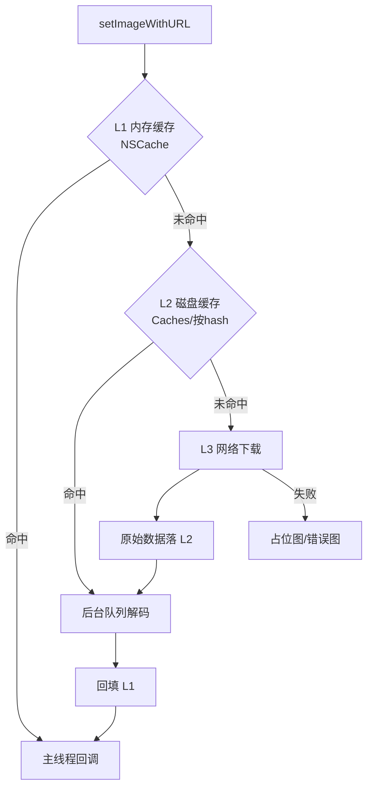

# 手写图片加载：三级缓存与磁盘策略设计

SDWebImage 和 Kingfisher 用久了，容易把图片加载当成黑盒——直到遇到定制需求：弱网下要显示缩略图再渐进原图、内存吃紧要按业务优先级清缓存、离线包里的图要走本地资源。这些需求逼你回到原理层。这篇把我们给老工程重写图片加载器的设计记下来，三级缓存、解码、磁盘策略一个都不少。

## 整体架构



关键设计点全在箭头方向：**磁盘命中也要回填内存**，**解码永远不在主线程**，**下载的是数据不是图**（存原数据，解码按当前需求做，同一份数据可以为不同尺寸的 ImageView 复用）。

## L1：NSCache 的三个正确用法

NSCache 自带内存压力自动清理，比字典 + 手动通知靠谱，但要会用：

```objective-c
// 1. 用 totalCostLimit 而不是数量限制——图片的成本是字节不是张数
NSCache *memCache;
memCache.totalCostLimit = 60 * 1024 * 1024; // 按占内存预算，低端机调小

// 2. cost 按解码后字节算，不是文件字节
NSUInteger cost = (NSUInteger)(image.size.width * image.size.height * 4);
[memCache setObject:image forKey:urlKey cost:cost];

// 3. 监听内存警告（NSCache 只自动清它知道的，业务可再加一档）
[[NSNotificationCenter defaultCenter]
    addObserverForName:UIApplicationDidReceiveMemoryWarningNotification
                object:nil queue:nil usingBlock:^(NSNotification *n){
    [memCache removeAllObjects]; // 激进但正确：图片缓存全可重建
}];
```

## 解码：最容易忽视的主线程炸弹

`[UIImage imageWithData:]` 创建的对象只是"带数据的壳"，真正的像素解码发生在**第一次绘制时**——也就是主线程。列表快速滚动时，主线程每行多付一次 JPEG 解码，掉帧就是这么来的。手写加载器的标配是后台预解码：

```objective-c
// 后台解码成位图上下文，主线程拿来即画
- (UIImage *)decodedImageWithData:(NSData *)data {
    UIImage *lazy = [UIImage imageWithData:data];
    UIGraphicsImageRendererFormat *fmt = [UIGraphicsImageRendererFormat defaultFormat];
    fmt.scale = lazy.scale;
    fmt.opaque = NO;
    UIGraphicsImageRenderer *r =
        [[UIGraphicsImageRenderer alloc] initWithSize:lazy.size format:fmt];
    return [r imageWithActions:^(UIGraphicsImageRendererContext *ctx) {
        [lazy drawAtPoint:CGPointZero]; // 解码在这一步、这个线程完成
    }];
}
```

进阶优化是给解码目标尺寸设上限：`UIGraphicsImageRenderer` 按 ImageView 实际显示尺寸缩放绘制，一张 4000×3000 的原图在 100pt 的头像位上，解码成本直接除以几十。SDWebImage 的 `transformer` 做的就是这件事，手写版没理由不做。

## L2：磁盘策略的四个决策

**命名：** URL 的 MD5/SHA256 做文件名，URL 带参数和 CDN 后缀时注意"同图不同 URL"的重复存储——先做 URL 归一化（去掉尺寸参数存原图，显示端缩放），这是磁盘占用减半的常见来源。

**目录：** `Library/Caches/`，接受系统清理，所有读取都要能优雅降级。

**淘汰：** LRU 太重，简单方案是"水位 + 时间"双阈值：超过 200MB 按最久未访问清到 150MB；单文件超过 30 天未命中清理。访问时间在内存里攒批落盘，别每次命中都碰磁盘元数据。

**格式：** 网络原图是什么存什么（WebP 存 WebP，别解码成 PNG 再存，体积翻五倍）。

## 取消与并发：工程成熟度的分水岭

功能跑通只是及格线，两个细节决定能不能上线：

**一，cell 复用下的过期回调。** ImageView 先加载 A 图，滑出去复用成 B，A 的网络回调姗姗来迟把 A 画在了 B 上——"图片串位"。解法是 tag 校验或 token 校验：

```objective-c
imgView.daisz_token = url; // 发起时记录
// 回调时：
if (![imgView.daisz_token isEqualToString:url]) return; // 过期回调，丢弃
```

**二，同 URL 并发合并。** 首屏 12 个格子引用同一张头像，不该发 12 次请求。维护一个"在途请求表"（URL → completion 数组），后来的订阅者挂到同一任务上，结果到达统一分发。请求数从 N 降到 1，弱网首屏省的就是这些冤枉流量。

## 我们最终留下的和没做的

上线的：三级缓存、后台预解码、URL 归一化、LRU 简化版淘汰、请求合并、token 防串位。  
主动不做的：渐进式解码（PROGRESSIVE_JPEG 业务收益小）、动图独立管线（GIF 播放内存大，直接产品降级为静态首帧）、预加载调度器（和滚动方向联动的预取，收益配不上复杂度）。

手写一遍图片加载的价值不在替换三方库——日常业务继续用 SDWebImage，它十年打磨的边角处理没必要重造。价值在于你从此知道那些"配置项"背后各是什么机器：`transformer` 是解码器，`cacheKeyFilter` 是 URL 归一化，`maxMemoryCost` 是 NSCache 的 cost 账本。**黑盒变白盒的那天，你才真正拥有排查图片问题的能力。**
