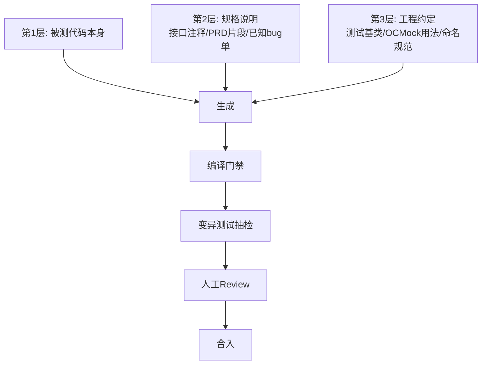

# 让 AI 写单元测试：一套能落地的工程流程

"用 AI 写测试"这个话题的教程很多，但多数停在"把代码丢给模型，它吐出一个测试文件"。真在项目里跑起来，会撞上一堵墙：生成的测试一半编译不过，另一半断言的是"代码现在是什么就断言什么"——这种测试只能锁死现状，防不了 bug。三个月实践下来，我摸索出一套流程，把 AI 从"代码生成器"调教成了"测试实习生"，记录一下。

## 为什么裸写 Prompt 效果差

直接 `帮我给这个类写单元测试`，会得到三种典型废品：

1. **翻译式测试**：把被测代码逐行翻译成断言，`add(1,2)` 断言 `== 3` 不是因为"规格说应该得 3"，而是因为"实现返回了 3"。实现改错，测试跟着改错。
2. **幻觉 API**：调用类里根本不存在的方法，或者拿 Swift 的 API 去测 OC 类。
3. **依赖真空**：真实初始化被测对象，网络、数据库全被拉起来，测试变成集成测试，一跑三分钟。

根因都一样：**AI 缺的不是智力，是上下文**——它不知道规格、不知道工程约定、不知道你的替身框架。

## 上下文三明治：流程核心

我把喂给 AI 的材料固定成三层，缺一层就降级人工补：



第 2 层是关键增量。实践做法：给核心类维护一个 `SPEC.md`（就放在测试目录旁），用自然语言写输入输出约定，例如：

```plaintext
## PriceCalculator
- 会员折扣与满减同时命中时，折后价再满减（顺序敏感，历史 bug #2341）
- 优惠券叠加上限 3 张，超出抛 CouponOverflow
- 金额一律分为单位整数，禁止浮点
```

这段不足 20 行的文字，就是"规格"与"翻译"的分水岭。把 SPEC 和代码一起喂进去，生成的断言立刻从"复述实现"变成"验证约定"。

## 第 3 层：把工程约定做成可粘贴的 few-shot

每个工程都有自己的测试方言。我在仓库里存了一份 `TESTING.md`，内容包括测试基类、OCMock 的标准用法、命名规范（`test_方法_场景_期望`），Prompt 里固定引用。效果最立竿见影的是**示例驱动**：给一个手写的高质量测试做样板，让 AI"照着这个风格写"，编译通过率和风格一致性大幅提升——比任何"请使用规范的测试风格"的形容词都有效。

## 编译门禁与幻觉过滤

生成结果先过机器再进人眼。CI 脚本里三步：

```bash
# 1. 只编译测试 target，不过直接打回（过滤幻觉 API 的主力）
xcodebuild build-for-testing -scheme AppTest -destination 'platform=iOS Simulator,name=iPhone 16'

# 2. 跑一遍，标记 flaky（同用例跑三次结果不一致的单独列出）
xcodebuild test -only-testing:AppTests/AIGenerated -resultBundlePath ./ai_test.xcresult

# 3. 统计断言密度，低于阈值（如每用例<2断言）的打回重写
```

经验值：这套门禁能拦掉 60~70% 的生成质量问题，剩下的才是人工 review 的范围。

## 变异抽检：测试真的能抓 bug 吗

编译过、跑过的测试可能仍是摆设。方法：对被测代码故意植入小改动（边界 `<` 改 `<=`、常量 +1），跑测试，**测试还全绿就说明它是废的**。全量变异成本高，我只对 AI 生成的测试做抽检：每个 PR 抽 2 个用例植入变异，连续两次抽检全绿的类，回收人工重写。这个指标（变异杀死率）成了我对 AI 测试质量的核心度量，比覆盖率诚实得多——覆盖率能刷，变异杀不掉。

## 人工 Review 的红线

AI 负责产量，人负责两件事：**断言的正当性**（这个期望值是来自规格还是来自实现？后者要重写）和**边界选择**（空、负、溢出、并发，AI 倾向只测主干路径）。Review 时发现最多的问题不是写错，是不测异常路径——这恰好是历史 bug 的高发区。

## 效果与边界

三个月数据：核心模块测试用例数翻了三倍，AI 生成占比约七成，配合变异抽检，线上回归 bug 有两次被单测拦截在合并前。也清楚看到边界：UI 测试、时序敏感的并发测试、依赖真实网络的场景，AI 产出的东西还是玩具。**把 AI 用在"逻辑密集、规格清晰"的地方**——计价、解析、状态机——投入产出比最高。

最后一句体会：这套流程里最值钱的产出不是测试代码，是那份 SPEC.md。它逼着团队把"口口相传的业务规则"写成了文字——测试有没有全过另说，规则第一次有了唯一出处，这已经是白赚的。
