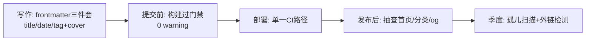

# VuePress 博客工程实践：从模板到生产环境的十二个坑

这个博客跑在 VuePress 2 + vuepress-theme-hope 上，百来篇文章，GitHub Pages 部署。看起来"模板一装就能用"的东西，真当工程维护起来，坑一个接一个。这篇把这一年多踩过的、修过的汇总成清单，给同样把 VuePress 当正经项目维护的人参考。

## 配置层的坑

**1. hostname 不要带 base 路径。** 最隐蔽的一个：`hostname: "https://user.github.io/vueblog"` 加上 `base: "/vueblog/"` 会拼出 `/vueblog/vueblog/` 的 `og:url`，页面浏览一切正常，只有搜索引擎收到的是错误规范链接。一行代码影响全站 SEO，排查只能 grep 产物：

```bash
# 构建后验证：产物里不该再出现双 base
grep -r "vueblog/vueblog" src/.vuepress/dist --include='*.html' | wc -l
```

**2. frontmatter 的 tag 是 YAML 列表，不是逗号串。** `tag: [西安,旅游,攻略]` 与 `- 西安,旅游,攻略` 都会把整串当成**一个**标签，标签页碎成一堆一次性目录。正确格式只能逐项一行。批量修复后还要治理分类法——标签收敛到 15~20 个，比格式正确更重要。

**3. date 决定时间线，缺省值不可靠。** 没有 `date` 时主题回退到 git 提交时间。如果你的历史是"一次性导入"的（ squash 导入、迁移备份），全站时间线会被压成导入当天。所有文章显式写 `date`，月份组页、timeline、RSS 排序全都依赖它。

**4. `public/` 整目录直拷，孤儿文件不会报错。** 模板自带的 demo 图、早期遗留的头像素材，只要躺在 `public/` 就原样进 dist。VuePress 不像 Vite 的 `import` 链路会做 tree-shake，`public/` 里 100MB 就给你上 100MB。定期跑一次"引用反查"：

```bash
# 列出 public 下未被任何 md/html 引用的文件
for f in $(find src/.vuepress/public -type f -printf '%P\n'); do
  grep -rq "$f" src/posts src/.vuepress/*.ts src/.vuepress/public/*.html || echo "orphan: $f"
done
```

## 写作层的坑

**5. Markdown 里的 HTML 会被 Vue 编译。** `<font>` 标签报 `Failed to resolve component`，`<用户名>` 这类尖括号占位符报 `Element is missing end tag`——构建直接失败。富文本导出的旧文章是重灾区，迁移时先跑一遍构建看警告。

**6. 代码围栏语言标识必须精确。** ` ```java文件 ` 让 Shiki 报 Missing highlighter 并放弃高亮；`objc`/`object-c`/`objectivec` 只有 `objective-c` 是对的。中文说明写在围栏外面，别塞进语言位。

**7. 相对路径图片是资产，外链图床是负债。** 七牛、某印象图床、各种"永久"图床，几年后批量 404。本地 `./img/` 走 Vite 资源管线（带哈希、随站部署），HTTPS 站引 `http://` 图还会被浏览器拦截。历史外链图能本地化的都本地化。

**8. 文件名里的空格和全角括号是 URL 噩梦。** `iOS 面试题收集.md` 的链接会被 percent-encode 成一串 `%E9%9D%A2%E8%AF%95`，`og:url` 长得没法看。文件名建议：无空格、无括号、中文可以。

## 构建与部署层的坑

**9. 双部署脚本打架。** CI（GitHub Actions → gh-pages）和手工 `deploy.sh`（推 Gitee）并存时，两边 dist 结构假设不同（根目录 vs 子目录），跑错一个全站白屏。部署路径唯一化，废弃的脚本删掉，别留"以防万一"。

**10. 大资源决定首屏生死。** 手机原图（3456×4608、6MB+）直接提交，列表页一拉就是几十 MB。上构建前批处理：长边 1600px、JPEG q82、PNG 转 WebP；视频不要进 git，放对象存储或 Releases。

**11. 构建警告清零是门禁不是洁癖。** `Failed to resolve component`、`Missing highlighter`、死链图片——每一条都对应线上一个坏页面。`npm run docs:build` 的 stderr 过 grep 检查，有 warning 就阻断部署，这个门禁让"改坏了"当场暴露而不是等读者举报。

**12. 产物验证要抽查语义而不只是文件存在。** 部署成功≠内容正确，发布后至少抽查三样：首页列表顺序（吃 date）、分类/标签页聚合（吃 frontmatter）、`og:url` 与 canonical（吃 hostname+base）。

## 一条总装线

把这些坑倒过来，就是维护清单：



静态站点工具链的坑，八成不在"功能不会用"，在**产物语义没人验证**——页面能打开不代表 `og:url` 对、时间线对、标签聚合对。把"构建能过"升级成"产物是对的"，VuePress 就从玩具变成了工程。
