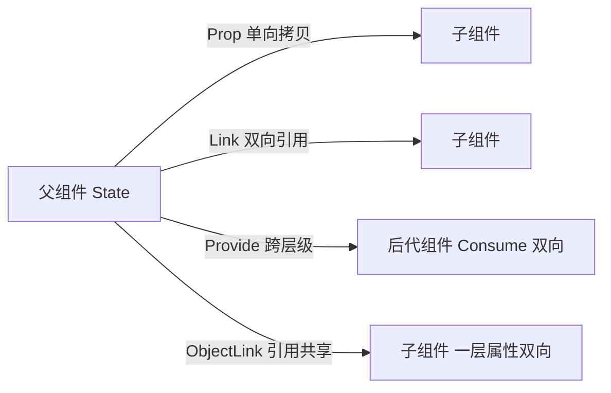

# 鸿蒙 ArkTS：状态装饰器的边界与坑

## 场景：改了数据，界面不动

去年开始接鸿蒙的活，UI 写起来比 UIKit 顺太多：声明式、数据驱动，`build` 里描述长什么样，状态变了界面自己刷新。但我第一次做「任务列表」这种界面时，还是撞上了最经典的一堵墙。

需求很朴素：一个任务列表，每行一个勾选框，勾选后标题变灰。数据是一个 `Task` 数组，`@State` 修饰，点击时在回调里改这一项的 `done` 字段：

```typescript
// Task 是个普通的 class
class Task {
  id: number = 0;
  title: string = '';
  done: boolean = false;
}

@Entry
@Component
struct TaskListPage {
  @State tasks: Task[] = [];

  build() {
    Column() {
      ForEach(this.tasks, (item: Task) => {
        TaskItem({ task: item })
      }, (item: Task) => item.id.toString())
    }
  }
}
```

结果：勾选后数据确实变了（日志打出来是对的），界面纹丝不动。加 `@Watch` 也收不到回调。这就是 ArkUI 状态管理的边界：**装饰器观察的是它自己那层，不是整棵对象树。**

## 分析：先分清单向、双向，再谈观察深度

新手（包括当时的我）容易把这几个装饰器按「作用域大小」来记，其实该按两个维度记：**同步方向**和**观察深度**。



| 装饰器 | 同步方向 | 观察深度 | 典型用法 |
| --- | --- | --- | --- |
| @State | 组件自己持有，父可传初值 | 变量本身 + 对象第一层属性 + 数组项增删 | 页面/组件内部状态 |
| @Prop | 父到子单向，子改不回父 | 本地副本的第一层 | 只读入参，如标题、配置 |
| @Link | 父子双向，同一份数据 | 与 @State 同 | 表单双向绑定、弹层选中项 |
| @Provide / @Consume | 跨任意层级，双向 | 同上 | 主题、用户信息，避免一层层透传 |
| @Observed + @ObjectLink | 引用共享，子改一层属性父可见 | 把「观察」推进到被传入的那个对象 | 列表项子组件 |

两个细节值得单独说。一是 `@Prop` 对对象类型是**本地拷贝**，父组件更新时整份覆盖子组件的修改，所以别拿 `@Prop` 做「子组件里编辑、父组件读回」的事，那种就该用 `@Link`。二是 `@Consume` 靠 key 匹配，祖先链上找不到对应的 `@Provide` 会直接编译不过，想留本地默认值就自己写初值。

## 坑：@State 只观察第一层

回到开头那个列表。`@State tasks: Task[]` 观察的是：数组本身被整体替换、数组项的增删和索引赋值，以及**如果**它是对象的话，对象第一层属性的赋值。而 `item.done = true` 改的是「数组元素这个 class 实例内部的属性」，属于第二层，ArkUI 的观察代理不会递归包进去，自然不触发刷新。

同理，`@State form: FormModel` 里改 `form.address.city` 也不会刷新。这不是 bug，是设计——递归代理整棵对象树的开销在移动端列表上不划算。

## 方案一：把改动「提」到第一层

最粗暴的办法，是让数组发生第一层能看到的变化：

```typescript
// 做法 A：索引赋值，触发数组变化，整行重建
this.tasks[index] = newTask;

// 做法 B：先改对象，再整体替换引用
const next = this.tasks[index];
next.done = !next.done;
this.tasks.splice(index, 1, next);
```

小列表、低频交互这样够用，代价是整行重建，长列表高频操作时能感觉到卡顿。

## 方案二：列表项拆成子组件，用 @Observed + @ObjectLink

这是官方推荐的正解，也是性能最好的做法：把行组件拆出来，`Task` 加 `@Observed`，行组件用 `@ObjectLink` 接。

```typescript
@Observed
class Task {
  id: number = 0;
  title: string = '';
  done: boolean = false;
}

@Component
struct TaskItem {
  @ObjectLink task: Task;

  build() {
    Row() {
      Checkbox()
        .select(this.task.done)
        .onChange((v: boolean) => {
          this.task.done = v;   // 第一层属性，父组件同步可见
        })
      Text(this.task.title)
        .fontColor(this.task.done ? Color.Gray : Color.Black)
    }
  }
}
```

`@ObjectLink` 不拷贝数据，拿到的就是父组件数组里那个实例，`@Observed` 给它包了一层代理，第一层属性的读写都在监听里。这样只有被改动的那一行刷新，其他行不动。

三条约束别忘：`@ObjectLink` 不能有本地初值，必须由父组件传入；它**不能整体重新赋值**（`this.task = new Task()` 编译不过），要换就换父组件数组里的元素；`@Observed` 依然只管第一层，对象里再嵌一层（比如 `task.assignee.name`），就得再拆一层子组件，或者上 V2。

## 方案三：深层嵌套，考虑 @ObservedV2 + @Trace

API 12 之后有 V2 状态管理：类标 `@ObservedV2`，需要观察的属性标 `@Trace`，可以递归多层，组件里配 `@Local`、`@Param` / `@Event`，还能用 `@Monitor` 监听一条路径：

```typescript
@ObservedV2
class Assignee {
  @Trace name: string = '';
}

@ObservedV2
class TaskV2 {
  @Trace done: boolean = false;
  @Trace assignee: Assignee = new Assignee();
}

@ComponentV2
struct TaskDetail {
  @Param task: TaskV2 = new TaskV2();

  // 监听一条完整路径，深层属性变了也会回调
  @Monitor('task.assignee.name')
  onNameChange(monitor: IMonitor) {
    console.info(`负责人改成 ${monitor.value?.now}`);
  }
}
```

代价是同一个组件里 V1、V2 装饰器不能混用，老项目一般只有新页面才敢开 V2。我的建议：V1 项目里，列表项一律走 `@Observed` + `@ObjectLink`；真正深层嵌套超过两层的模型（表单、购物车），再评估 V2。

## 顺带记录：几个不报错但容易误判的细节

**@Watch 不是 diff。** 我一开始想拿 `@Watch` 兜住「第二层属性变化」，试了才发现它触发的条件和 UI 刷新是同一套规则：变量本身被赋新值、数组增删或者索引替换会回调，改元素内部的属性照样不回调。所以它适合「状态变了要落盘、要埋点」，不能当数据变更监听器使。

**@Prop 的本地修改会被覆盖。** 子组件里改 `@Prop` 不报错也不回传，看着人畜无害；但父组件只要再同步一次，本地那份编辑就被整份冲掉。「在子组件里编辑、提交时交给父组件」这种交互，一开始就该用 `@Link`，或者走 `@Param` 加 `@Event` 的回调上报。另外 `@Link` 传参少写一个 `$`，编译期就会拦下，但报错位置指向子组件，别真跑去子组件里翻，漏的是父组件那一侧的写法。

**列表上千行就换 LazyForEach。** `ForEach` 是一次性把子组件全建出来，长列表的首帧和内存都吃亏；换成 `LazyForEach` 配自己的数据源实现之后，只有进入屏幕范围的几行会建立观察和构建，`@ObjectLink` 的刷新范围也跟着变小。我把那个任务列表从 `ForEach` 切过去，几百条数据进页面的耗时是肉眼可见地短了。

## 小结

ArkUI 的状态装饰器不要按「哪个更高级」来选，先问两个问题：这份数据要不要回传父组件（不要就 `@Prop`，要就 `@Link`，隔得多就 `@Provide` / `@Consume`），改动落在第几层（第一层用 `@State`，第二层起用 `@ObjectLink` 或 `@Trace`）。我现在的习惯是，写列表之前先决定行的粒度要不要拆子组件，把 `@ObjectLink` 放进设计里，而不是等「界面不刷新」了再回来补——补的时候往往要把一大段 build 拆开，比一开始就拆麻烦得多。
