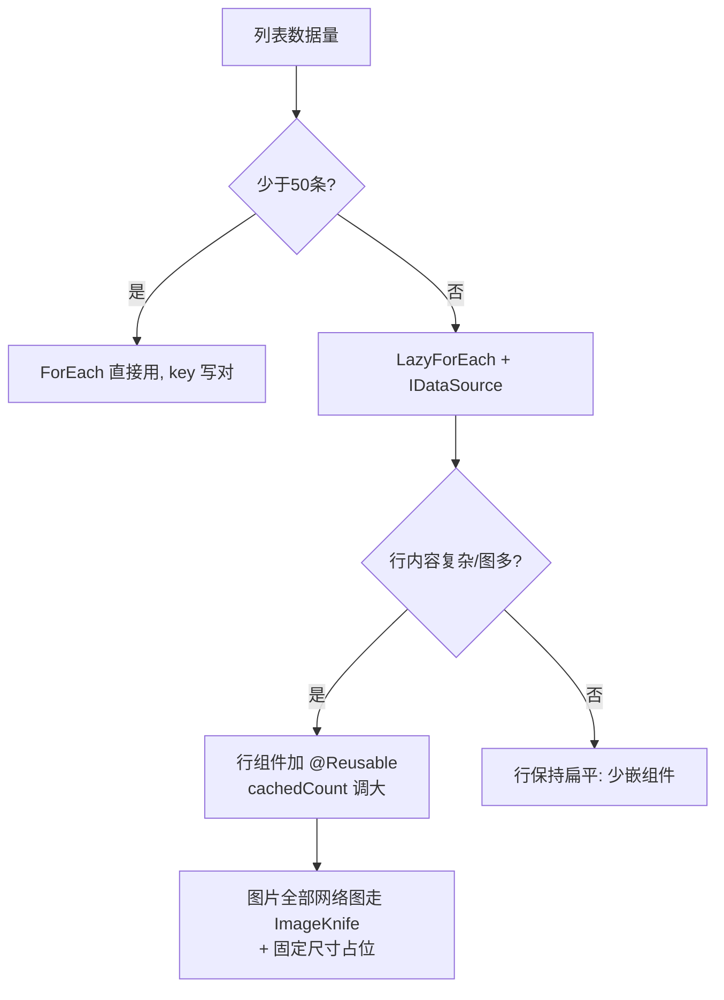

# 鸿蒙 ArkUI 长列表实战：LazyForEach 的正确打开方式

鸿蒙 App 里最容易写出性能问题的地方，就是一个塞了几千条数据的长列表。新手期我把 ForEach 用到底，列表一长就掉帧、内存曲线爬得像心电图。改到 LazyForEach 之后才明白：ArkUI 的列表优化不是换个 API 的事，是一整套"数据源 + 复用 + 缓存"的纪律。这篇把这套东西一次讲透。

## ForEach 的原罪：一次建完

ForEach 的语义是"给数组每项都当场建组件"。三千条数据的评论列表，ForEach 会在首帧前把三千个组件全量构建出来——哪怕用户只看得到七八条。

```typescript
// ❌ 大列表用 ForEach: 首帧卡、内存高
List() {
  ForEach(this.comments, (item: Comment) => {
    ListItem() { CommentRow({ data: item }) }
  }, (item: Comment) => item.id.toString())
}
```

LazyForEach 的语义是"只构建视口附近的项，滑出视口的销毁回收"。但它要求你提供**实现了 IDataSource 的数据源**，而不是裸数组——这是很多人"换了 API 没变快"的第一步：DataSource 写得不对，懒加载就是空谈。

## IDataSource 的最小正确实现

```typescript
class CommentDataSource implements IDataSource {
  private listeners: DataChangeListener[] = []
  private items: Comment[] = []

  totalCount(): number { return this.items.length }
  getData(index: number): Comment { return this.items[index] }

  registerDataChangeListener(l: DataChangeListener): void {
    if (this.listeners.indexOf(l) < 0) this.listeners.push(l)
  }
  unregisterDataChangeListener(l: DataChangeListener): void {
    const i = this.listeners.indexOf(l)
    if (i >= 0) this.listeners.splice(i, 1)
  }

  // 关键：所有变更都要走通知，直接改 items 列表不刷新
  addItems(more: Comment[]): void {
    const start = this.items.length
    this.items.push(...more)
    this.listeners.forEach(l => {
      for (let i = start; i < this.items.length; i++) l.onDataAdd(i)
    })
  }

  updateItem(index: number, item: Comment): void {
    this.items[index] = item
    this.listeners.forEach(l => l.onDataChange(index))
  }

  removeItem(index: number): void {
    this.items.splice(index, 1)
    this.listeners.forEach(l => l.onDataDelete(index))
  }
}
```

三个铁律：**增删改必须调对应的 `onDataAdd/onDataDelete/onDataChange`**，忘了通知就是"数据变了界面不动"；**能用单项通知就别 `reload()` 全量**（`onDataReloaded` 会让所有可见项重建，滚动位置还可能丢）；**index 越界是崩点**，删除后立刻刷新要防住旧 index 的访问。

## 复用：@Reusable 治"卡顿的根"

LazyForEach 省的是构建数量，滑得快时"边滑边建"照样掉帧。`@Reusable` 组件让滑出的组件树不销毁而是回炉重造数据：

```typescript
@Reusable
@Component
struct CommentRow {
  @State data: Comment = new Comment()

  aboutToReuse(params: Record<string, Object>): void {
    // 复用时手动同步外部传入的状态，漏了就是"列表串数据"
    this.data = params.data as Comment
  }

  build() {
    Row() { /* 头像 + 文本 + 点赞 */ }
  }
}
```

两个坑：复用组件内部的 `@State` **不会自动重置**，`aboutToReuse` 里不更新的数据会带着上一个用户的痕迹出场——"点赞状态串了"就是这么来的；`@Reusable` 装饰的组件复用池按类型匹配，层级太深或子组件没标复用，收益会大打折扣。

## 缓存窗口与预加载

List 容器上还有几个直接影响顺滑度的参数：

| 参数 | 作用 | 建议 |
|---|---|---|
| `cachedCount` | 视口外预缓存的项数 | 图多的高列表调到 5~8，默认偏小 |
| `onScrollIndex` | 首尾可见 index 回调 | 尾部触达时分页拉数据 |
| `.linearGradient`/背景 | 透明列表合并背景 | 少用每行一个背景图 |
| `edgeEffect` | 回弹效果 | `EdgeEffect.None` 长列表更省电 |

```typescript
List({ space: 8 }) {
  LazyForEach(this.dataSource, (item: Comment) => {
    ListItem() { CommentRow({ data: item }) }
  }, (item: Comment) => item.id.toString())   // 第三参 key 必须稳定且唯一
}
.cachedCount(6)
.onScrollIndex((first: number, last: number) => {
  if (last > this.dataSource.totalCount() - 10) this.loadMore()
})
```

key 生成函数是最后一个隐形雷：用数组下标当 key，列表插入删除后 key 全部错位，复用机制失效还可能出现动画怪象；key 要取**数据自身的稳定唯一值**（id），"看起来会变的字段"（如标题）不要用。

## 一张决策图



## 写在最后

这套组合拳打完，我们的动态流列表在中端真机上从"快速滑动肉眼可见白块"变成稳定 60 帧附近，内存峰值降了约三分之一。鸿蒙的列表优化没什么玄学：ForEach 管数量、@Reusable 管复用、cachedCount 管预取、key 管身份。四样各就位，列表自然顺——这条经验从 UITableView 时代讲到 RecyclerView 时代，如今轮到 ArkUI，内核一个字没变。
